# 에스크로 구조 — 그림으로 보기

**작성** 2026-09-08 · **기준** 브랜치 `bc-feature/job-escrow`, 커밋 `e6acb56`

---

## 1. 파일 구조와 의존 관계

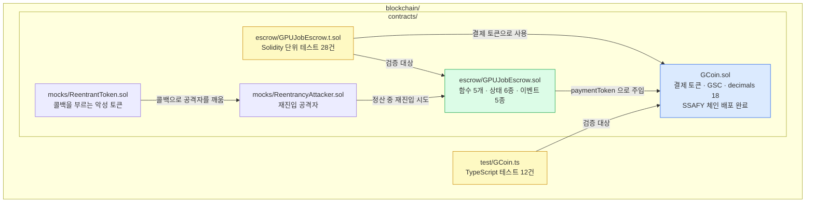

**에스크로가 GCoin 을 직접 import 하지 않습니다.** 생성자에서 주소만 받으므로 토큰을 갈아 끼울 수 있습니다. 헌법 원칙 V 입니다.

---

## 2. 상태 기계 — 지금

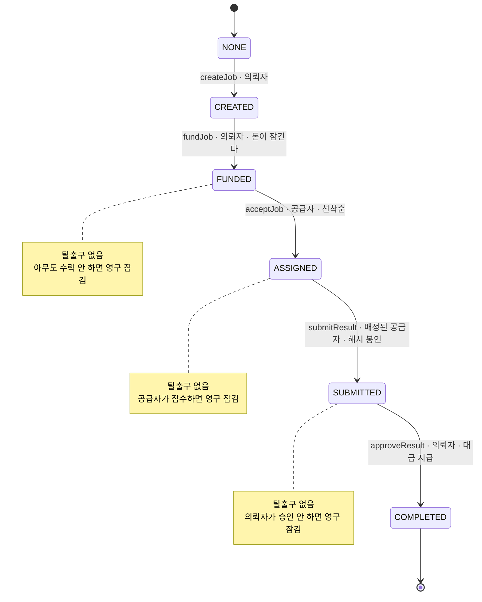

**빠져나가는 길이 `approveResult` 하나뿐입니다.** 헌법 원칙 II 위반이며 활성 예외 EX-1 로 등재되어 있습니다. 그래서 `chainid 31221` 배포를 코드로 막아 두었습니다.

---

## 3. 상태 기계 — 취소·타임아웃을 붙인 뒤 (계획)

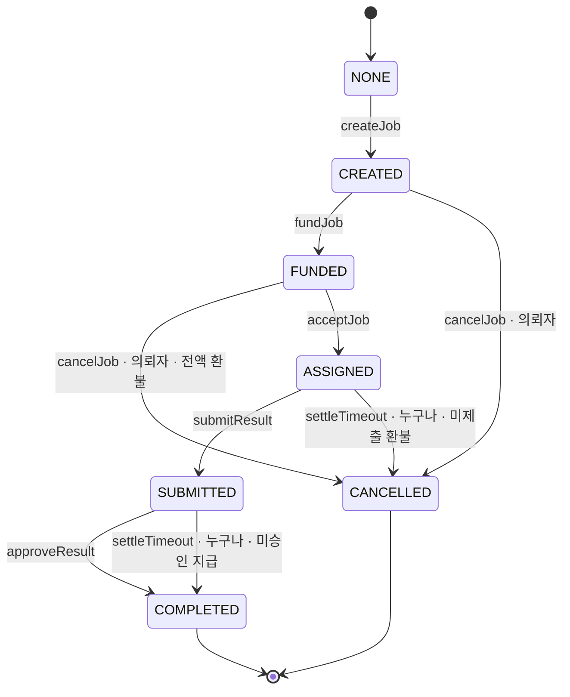

**모든 대기 상태에서 나가는 길이 생깁니다.** 이게 완성되면 EX-1 을 닫고 체인 가드를 지웁니다.

---

## 4. 한 바퀴 — 누가 누구에게 무엇을 보내는가

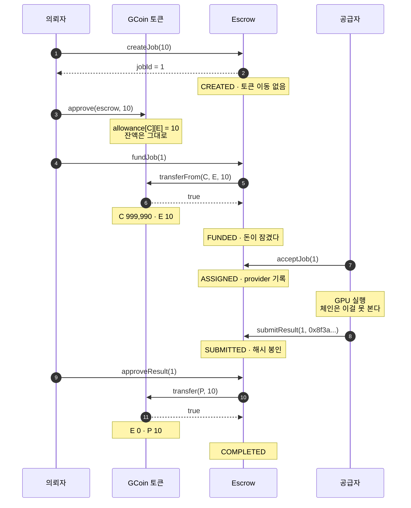

**지갑 서명이 세 번 필요합니다.** `createJob`, `approve`, `fundJob` 입니다. `approve` 와 `fundJob` 이 나뉜 이유는 ERC-20 에 밀어넣기가 없기 때문입니다.

---

## 5. 잔액이 어떻게 변하는가

| 단계 | 의뢰자 | 에스크로 | 공급자 | allowance |
|---|---:|---:|---:|---:|
| 시작 | 1,000,000 | 0 | 0 | 0 |
| `createJob` | 1,000,000 | 0 | 0 | 0 |
| `approve` | 1,000,000 | 0 | 0 | **10** |
| `fundJob` | **999,990** | **10** | 0 | **0** |
| `acceptJob` | 999,990 | 10 | 0 | 0 |
| `submitResult` | 999,990 | 10 | 0 | 0 |
| `approveResult` | 999,990 | **0** | **10** | 0 |

**토큰이 실제로 움직이는 곳은 `fundJob` 과 `approveResult` 둘뿐입니다.**

---

## 6. 함수 하나의 내부 — CEI 순서

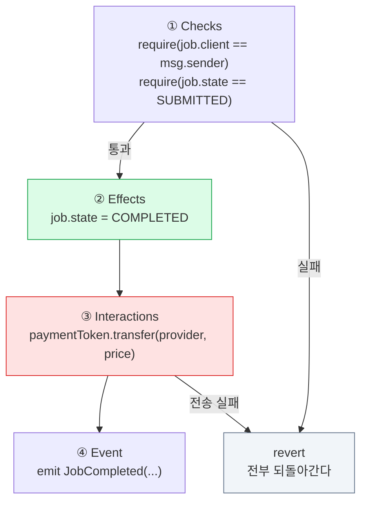

**②가 ③보다 먼저입니다.** 순서를 바꾸면 재진입이 열립니다.

---

## 7. 재진입 공격 — 순서가 왜 중요한가

### 잘못된 순서 (송금 먼저)

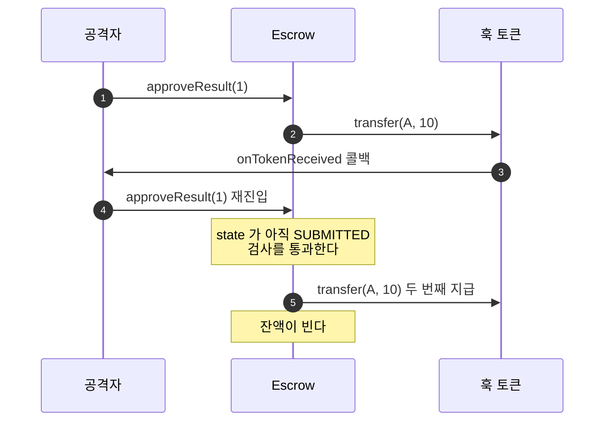

### 지금 코드 (상태 먼저)

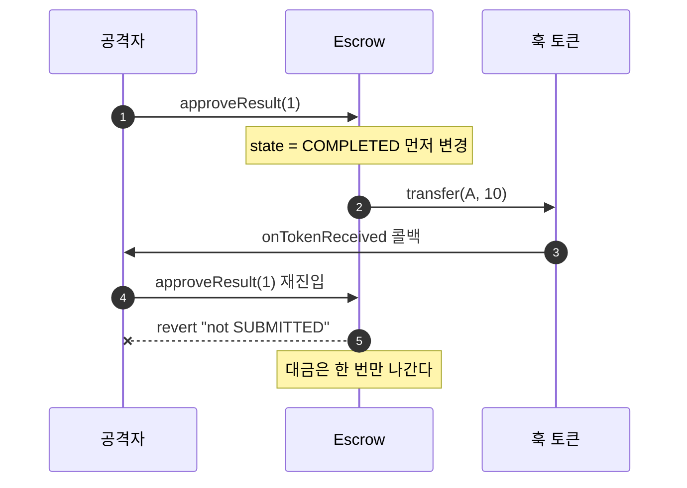

`ReentrantToken` 과 `ReentrancyAttacker` 로 이 공격을 실제로 재현하는 테스트가 구 브랜치에 4건 있고, 이번 모듈로 옮기는 작업이 남아 있습니다.

---

## 8. 테스트 구조

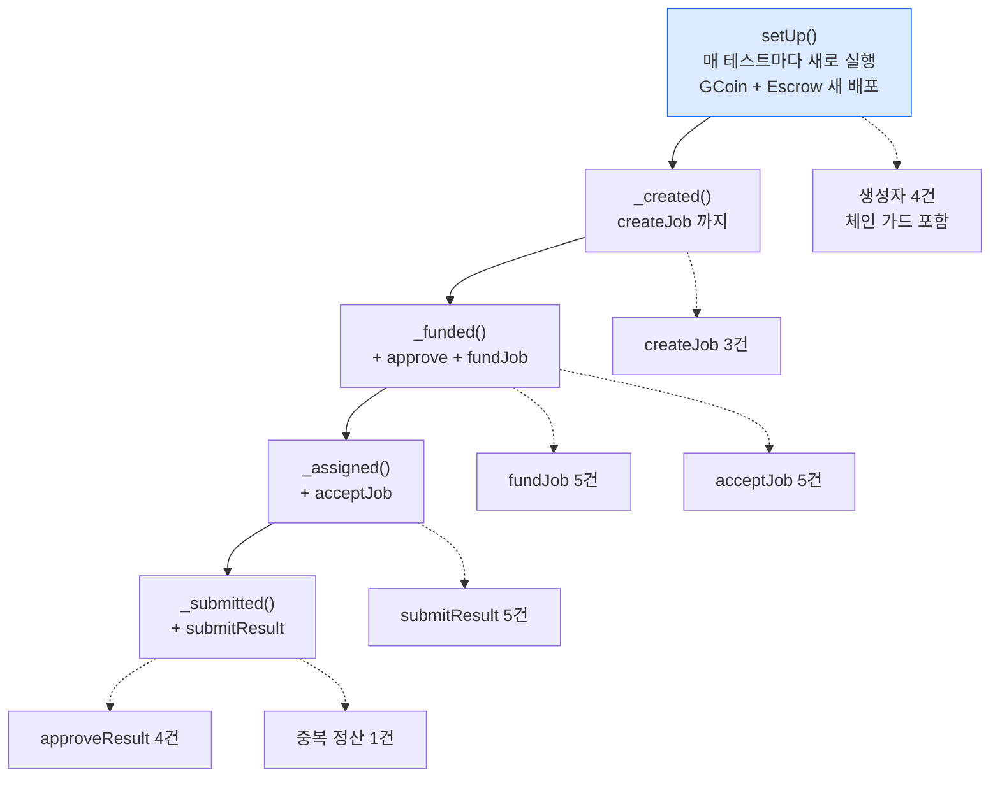

**보조 함수가 계단으로 쌓입니다.** `SUBMITTED` 상태가 필요한 테스트는 `_submitted()` 한 줄이면 됩니다.

---

## 9. 치트코드 — 테스트에서만 쓰는 반칙 도구

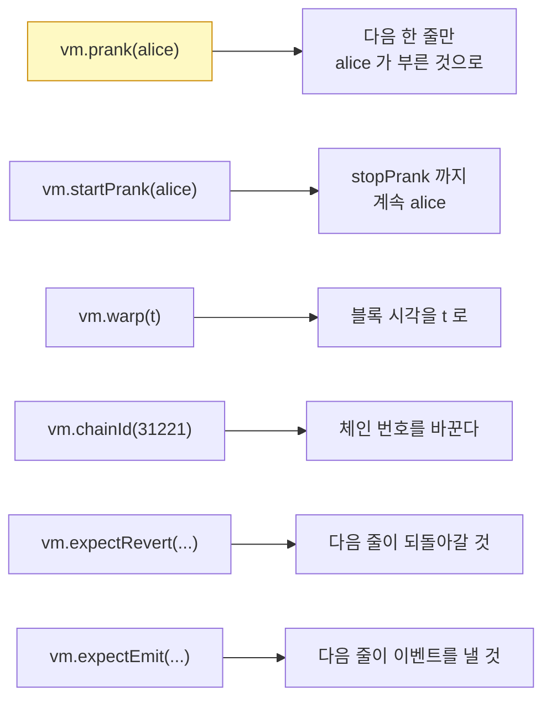

**`vm.prank` 은 일회용입니다.** 그래서 `_funded()` 안에서 두 번 나옵니다.

```solidity
vm.prank(client);
token.approve(address(escrow), PRICE);   // 이 줄만 client
vm.prank(client);                        // 다시 걸어야 한다
escrow.fundJob(jobId);                   // 이 줄도 client
```

---

## 10. 권한 배치의 기준

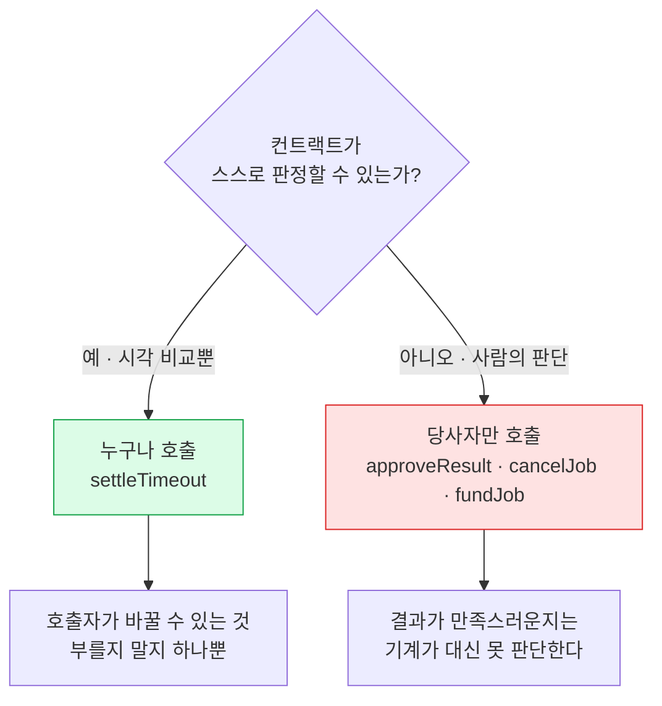

---

## 11. 지금 위치

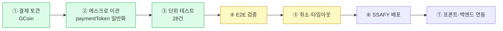

초록이 끝난 것, 노랑이 다음 차례입니다. **⑤가 끝나야 ⑥이 열립니다.** 체인 가드가 그때까지 배포를 막습니다.
