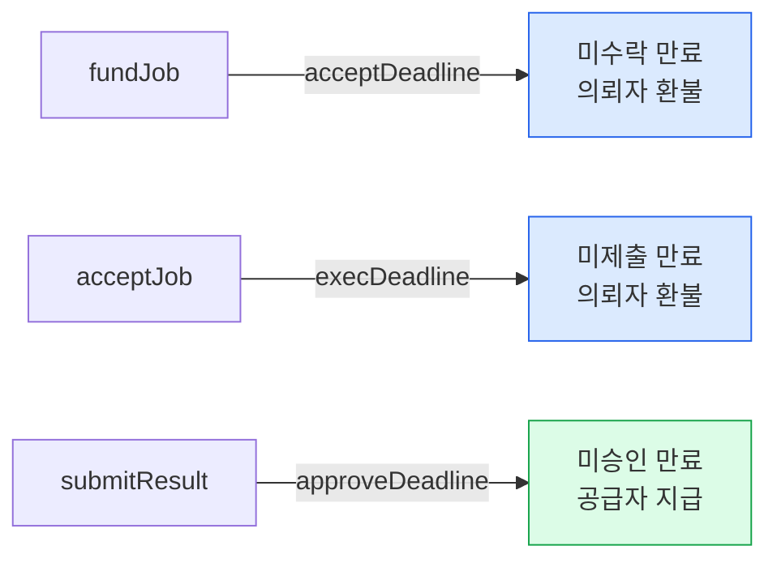
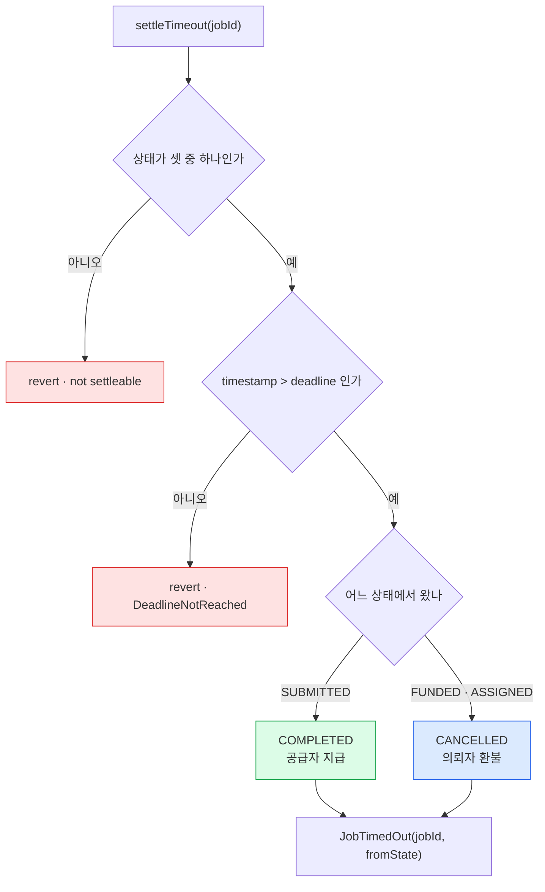
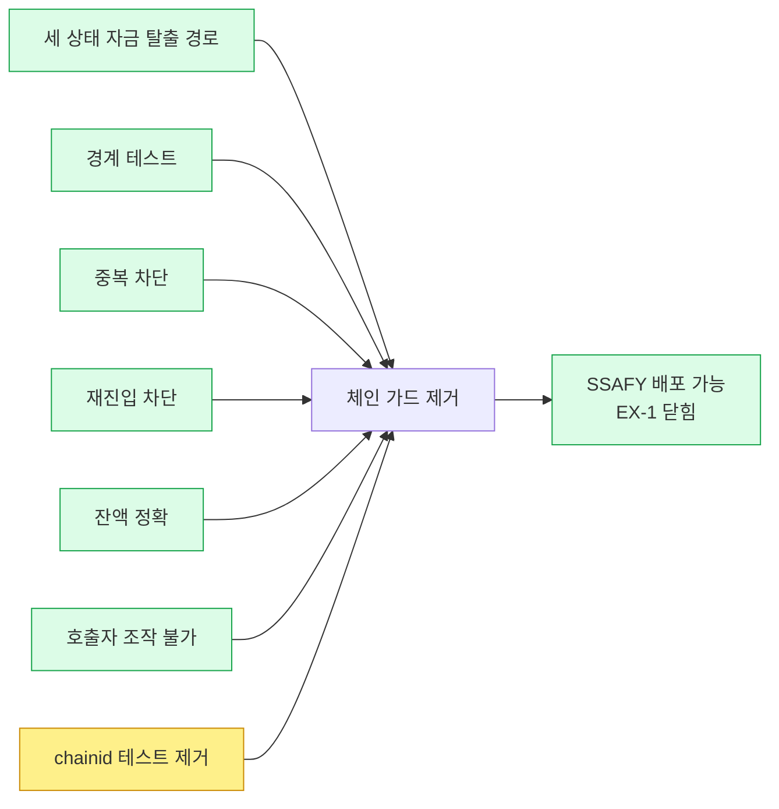

# 취소·타임아웃 구현 기록

**작성** 2026-09-08 · **커밋** `7d7ab98` · **브랜치** `bc-feature/job-escrow`

동한님 리뷰 답변(Q1~Q4)을 반영해 자금 회수 경로를 열었다. 이 문서는 **무엇을 왜 그렇게 만들었는지**를 남긴다.

---

## 1. 무엇이 바뀌었나

| | 이전 | 지금 |
|---|---|---|
| 상태 | 6종 | **7종** (`CANCELLED` 복귀) |
| 함수 | 5개 | **7개** (`cancelJob`·`settleTimeout`) |
| 이벤트 | 5종 | **7종** |
| 시한 | 없음 | **3개** |
| 생성자 인자 | 1개 | **4개** |
| 테스트 | 28건 | **72건** (Solidity 60 + Node 12) |
| 컨트랙트 | 162줄 | 277줄 |

---

## 2. 설계 결정 다섯

### 2-1. 시한을 셋으로 늘렸다

처음 제안은 둘이었다. 동한님이 **`FUNDED` 구멍**을 짚으셨다. 예치는 했는데 아무도 수락하지 않으면 그 자리에서 잠긴다.



### 2-2. `deadline` 필드는 하나다

상태마다 필드를 따로 두지 않고 **하나를 계속 덮어쓴다.**

```solidity
fundJob        job.deadline = now + acceptDeadline;
acceptJob      job.deadline = now + execDeadline;
submitResult   job.deadline = now + approveDeadline;
```

한 작업은 한 번에 한 상태에만 있으므로 시한도 하나면 충분하다. 스토리지도 `client(20) + state(1) + deadline(8) = 29바이트` 로 여전히 한 슬롯이다.

### 2-3. 경계는 겹치지 않게 잘랐다

같은 블록에 담긴 트랜잭션은 **전부 같은 `block.timestamp`** 를 본다. 정상 함수와 타임아웃이 동시에 유효하면 순서에 따라 결과가 뒤집힌다.

동한님 해법은 **두 구간을 겹치지 않게 만드는 것**이었다. 확률을 낮추는 게 아니라 가능성을 없앤다.

```solidity
acceptJob      if (block.timestamp > job.deadline)  revert DeadlineExpired();
submitResult   if (block.timestamp > job.deadline)  revert DeadlineExpired();
settleTimeout  if (block.timestamp <= job.deadline) revert DeadlineNotReached();
```

| 블록 시각 | 정상 함수 | `settleTimeout` |
|---|---|---|
| `timestamp <= deadline` | ⭕ | ❌ |
| `timestamp > deadline` | ❌ | ⭕ |

**정각은 정상 함수 쪽이다.** 오류 이름 둘은 같은 시한을 반대 방향에서 부딪히는 것이다.

| 오류 | 뜻 |
|---|---|
| `DeadlineExpired` | **늦게** 왔다. 정상 함수가 시한을 넘겼다 |
| `DeadlineNotReached` | **일찍** 왔다. 정산이 시한 전에 시도됐다 |

### 2-4. `acceptJob` 에도 시한 검사를 넣었다

동한님 문서에 없던 항목이다. 없으면 이렇게 된다.

```
14:00  fundJob        수락 시한 16:00
16:30  시한 지남      settleTimeout 으로 환불 가능한 상태
16:31  acceptJob      막지 않으면 통과
       → ASSIGNED 로 바뀌고 시한이 17:31 로 새로 걸림
       → 의뢰자 환불이 한 시간 더 밀림
```

**만료된 작업을 되살려 환불을 계속 미룰 수 있다.** 악의가 없어도 우연히 발생한다.

### 2-5. `cancelJob` 에는 시한 검사를 넣지 않았다

경계 검사가 필요한 곳은 **결과가 갈리는 자리**뿐이다.

| 함수 | 시한 후 결과 |
|---|---|
| `cancelJob` (FUNDED) | 의뢰자 환불 · `CANCELLED` |
| `settleTimeout` (FUNDED) | 의뢰자 환불 · `CANCELLED` |

**둘이 같다.** 어느 쪽이 먼저 실행되든 상관없고 나머지는 `require` 에 걸린다. 그래서 검사를 넣지 않았고, 그 판단을 `test_cancelJob_stillWorksAfterAcceptDeadline` 이 문서 대신 설명한다.

`CREATED` 취소는 범위 밖이다. 예치 전이라 잠길 자금이 없다.

---

## 3. `settleTimeout` — 세 갈래인데 코드는 두 갈래



`FUNDED` 와 `ASSIGNED` 는 처리가 같다. 둘 다 **공급자가 결과를 만들어내지 못한 경우**라 의뢰자가 돈을 돌려받는다.

### 호출자는 `jobId` 만 넘긴다

```solidity
function settleTimeout(uint256 jobId) external
```

수령자도 금액도 방향도 인자에 없다. 전부 `fromState` 와 `job` 에서 꺼낸다. 그래서 누구나 열어도 안전하다.

### `fromState` 를 먼저 복사하는 이유

상태를 바꾸고 나면 원래 값을 잃는다. `JobTimedOut(jobId, fromState)` 로 **어디서 끝났는지**를 알리려면 그전에 기억해 둬야 한다.

### 이벤트가 짝으로 나온다

```
만료 환불  →  JobCancelled  +  JobTimedOut
취소 환불  →  JobCancelled
```

`JobCancelled` 만 보면 "의뢰자가 취소" 인지 "시한 만료" 인지 구분이 안 된다. **백엔드가 화면에 두 가지를 다르게 보여 줄 수 있게** 하려는 것이다.

---

## 4. 테스트

### 숫자

| 파일 | 건수 |
|---|---|
| `GPUJobEscrow.t.sol` | 55 |
| `Reentrancy.t.sol` | 5 |
| `test/GCoin.ts` (기존) | 12 |
| **합계** | **72** |

### 동한님 지정 12항목 대조

| # | 항목 | 건수 |
|---|---|---|
| 1 | 세 상태 만료 전 호출 실패 | 3 |
| 2 | 정각에서 정상 성공·타임아웃 실패 | 2 |
| 3 | 직후 정상 실패·타임아웃 성공 | 2 |
| 4 | `FUNDED` 만료 → 의뢰자 환불 | 1 |
| 5 | `ASSIGNED` 만료 → 의뢰자 환불 | 1 |
| 6 | `SUBMITTED` 만료 → 공급자 지급 | 1 |
| 7 | 누구나 호출 가능 | 1 |
| 8 | 호출자가 수령자·금액·방향 못 바꿈 | 1 |
| 9 | 만료 이후 정상 함수 차단 | 3 |
| 10 | 중복 타임아웃·환불·정산 차단 | 2 |
| 11 | 재진입 차단 | 5 |
| 12 | 종료 상태마다 잔액 0 | 정산 테스트 전부 |

### 경계 테스트는 짝으로 쓴다

```solidity
vm.warp(_deadline(jobId));                              // 정각
vm.expectRevert(GPUJobEscrow.DeadlineNotReached.selector);
escrow.settleTimeout(jobId);                            // 타임아웃 실패
escrow.acceptJob(jobId);                                // 정상 함수 성공
```

**한 테스트 안에서 둘을 같이 본다.** 하나만 검사하면 "정각에 둘 다 되는" 겹침을 못 잡는다.

`_deadline(jobId)` 로 컨트랙트에 저장된 값을 **읽어서** 쓴다. 상수로 다시 계산하면 계산식이 틀렸을 때 테스트도 같이 틀린다.

---

## 5. 재진입 — 공격자를 다시 짰다

### 옛 공격자는 아무것도 증명하지 못했다

구 브랜치 공격자는 `submitResult` 로 재진입했다. **그 함수는 돈이 안 움직인다.** 막혀도 자금 안전이 증명되지 않는다.

돈이 나가는 자리를 다시 세면 넷이고, 받는 쪽은 둘이다.

```
cancelJob                        → 의뢰자
settleTimeout (FUNDED·ASSIGNED)  → 의뢰자
approveResult                    → 공급자
settleTimeout (SUBMITTED)        → 공급자
```

그래서 공격자도 둘로 나눴다.

| 공격자 | 역할 | 재진입 통로 |
|---|---|---|
| `ReentrantClient` | 악성 의뢰자 | 환불받는 순간 `cancelJob` 재호출 |
| `ReentrantProvider` | 악성 공급자 | 대금받는 순간 `settleTimeout` 재호출 |

### 피해자를 심어야 공격이 성립한다

에스크로에 **공격자 돈만 있으면** 두 번째 인출은 잔액 부족으로 실패한다. 그러면 CEI 덕분에 막힌 것인지 돈이 없어서 막힌 것인지 구분할 수 없다.

```solidity
function _seedVictimJob() internal returns (uint256 jobId)
```

**남의 돈이 있어야 진짜 도둑질이 성립하고, 그걸 막는지를 볼 수 있다.**

### 테스트가 진짜인지 확인했다

CEI 순서를 **일부러 뒤집어** 봤다.

```solidity
bool ok = paymentToken.transfer(job.client, refund);   // 송금 먼저
job.state = JobState.CANCELLED;                        // 상태 나중
```

```
1) test_cancelJob_reentrancyIsBlocked()
   Error: attacker drained extra funds: 1010 != 1000
```

**공격자가 10 GSC 를 더 가져갔다.** 자기 예치금을 두 번 환불받았고 차액은 피해자 지갑에서 나왔다.

통과하는 테스트가 사실은 아무것도 검사하지 않는 경우가 흔하다. 뒤집었을 때 실패하는 것을 봤으므로 지금 통과하는 것이 우연이 아니다.

`test_hookTokenActuallyCallsBack` 도 같은 목적이다. **콜백이 실제로 불렸는지**를 먼저 확인해서, 공격이 시도조차 안 됐는데 "막혔다" 고 넘어가는 상황을 막는다.

---

## 6. 체인 가드 제거 조건



**여섯이 찼고 하나 남았다.** 마지막은 가드를 지우는 작업 자체다.

---

## 7. 남은 것

| 순서 | 할 일 |
|---|---|
| 11 | `GPUProtocol.e2e.ts` 3건 — 정상 / 환불 / 무응답 지급 |
| 12 | 체인 가드와 `test_constructor_revertsOnSsafyChain` 제거, 헌법 EX-1 닫기 |
| 13 | MR |

그리고 동한님께 확인받을 것이 하나 있다.

> **`acceptJob` 의 시한 검사**는 리뷰 문서에 없던 항목이다. 만료된 작업을 수락해 환불을 미루는 것을 막으려고 넣었다. 경계 원칙을 그대로 적용한 것이라 문제없다고 보지만 사후 확인이 필요하다.
