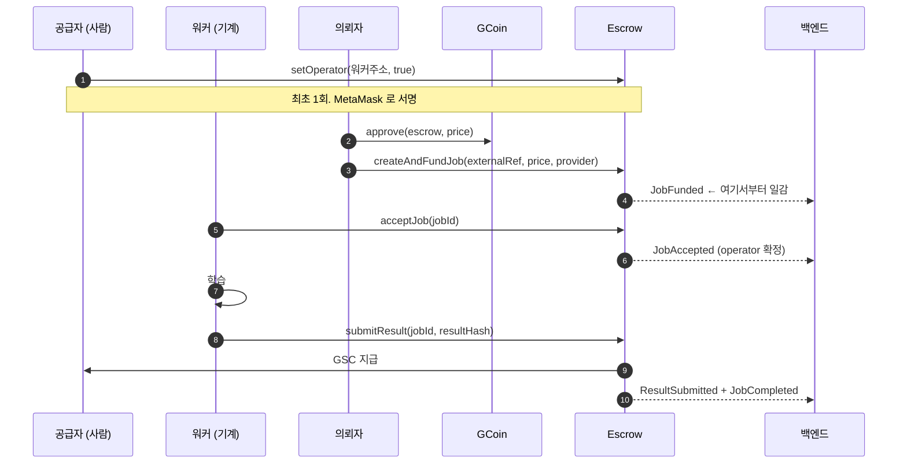
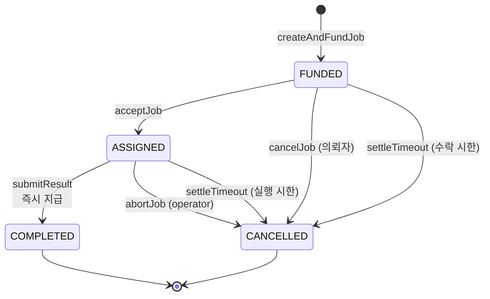
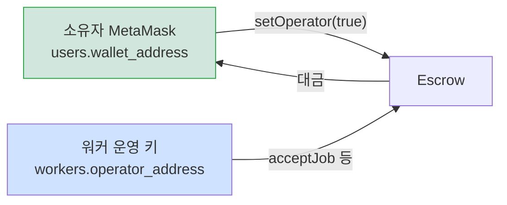

# 에스크로 연동 규격 — 백엔드·프론트·워커용

**작성** 김상해 · **갱신** 2026-09-11
**컨트랙트 커밋** `87055d6` (체인 가드 제거) · **검증** 103 passing (Solidity 86, Node.js 17)

> **이 문서와 `abi/GPUJobEscrow.json` 이 정본입니다.**
> 메신저로 오간 규격안·정정·확정 문서는 협의용이었고 모두 폐기합니다.
> 아래 시그니처는 컴파일 산출물에서 직접 뽑았습니다. 손으로 옮겨 적은 것이 아닙니다.

> **SSAFY 체인 배포는 `S15P21E204-155` 에서 진행합니다.** 생성자의 체인 가드는
> 제거했습니다. 배포하기 전까지는 로컬 체인에서 개발하시고, 배포한 주소는
> 14장에 적어 두고 함께 공지합니다.

---

## 0. 한 장 요약



**대금은 언제나 사람 지갑(`provider`)으로 갑니다.** 기계는 서명만 합니다.

---

## 1. 상태 다섯

```
0  NONE        존재하지 않는 작업을 조회했을 때
1  FUNDED      대금이 잠기고 정산 주소가 확정됨
2  ASSIGNED    수락되어 job.operator 가 확정됨
3  COMPLETED   결과가 봉인되고 지급이 끝남
4  CANCELLED   취소·반납·시한 만료로 환불됨
```



**지급 경로는 하나, 환불 경로는 셋입니다.** 승인 단계는 없습니다.

`stateEnum` 은 `abi/GPUJobEscrow.json` 에도 들어 있습니다. ABI 만으로는 `uint8` 로만 보여 이름을 알 수 없기 때문입니다.

---

## 2. 두 주소의 역할

```
provider   users.wallet_address       정산 주소. 대금이 여기로 간다
operator   workers.operator_address   온체인 호출 권한. 대금과 무관
```

공급자 쪽 함수는 사람 없이 자동으로 불려야 하므로 **프로그램이 키를 들고 있어야** 합니다. 그 키를 사람의 MetaMask 와 같게 둘 수 없어 역할을 나눴습니다. 그 프로그램은 **워커**입니다. 아래 "operator 개인키는 워커가 보관합니다" 를 보십시오.

**의뢰자가 지정하는 것은 `provider`(사람 지갑)입니다.** 후보 목록에 실을 값도 이것입니다.

### 승인이 없으면 작업을 받지 못합니다

```solidity
function setOperator(address operator, bool allowed) external
```

정산 주소 본인이 자기 기계를 승인합니다. 승인하지 않으면 **본인만** 수락할 수 있습니다.



### 승인 여부 확인

```solidity
function isOperator(address provider, address operator) external view returns (bool)
```

`public` 매핑이라 자동 조회 함수가 생깁니다. 이벤트로도 알 수 있습니다.

```solidity
event OperatorUpdated(address indexed provider, address indexed operator, bool allowed)
```

**두 경로를 함께 쓰시기를 권합니다.** 목록 화면은 이벤트로 캐시하고, 작업 배정 직전에는 온체인 조회로 확인합니다.

### 후보 목록에서 거를 조건 둘

```
users.wallet_address 가 있어야 한다              (정산 주소 등록)
isOperator[wallet][operator] == true 여야 한다   (권한 승인)
```

**하나라도 빠지면 후보에서 빼 주십시오.** 그대로 두면 의뢰자가 골랐을 때 예치는 되고 수락이 안 되어 시한 만료 환불로 흘러갑니다.

### 승인 취소는 진행 중 작업을 깨지 않습니다

승인 검사는 `acceptJob` 에서 한 번만 합니다. 그 시점에 `job.operator` 가 확정되고, 이후에는 그 주소 본인인지만 봅니다.

```
acceptJob      승인 검사 → job.operator 확정
submitResult   msg.sender == job.operator
abortJob       msg.sender == job.operator
```

12시간 학습 도중에 사용자가 실수로 승인을 취소해도 제출이 막히지 않습니다. 그리고 **승인된 다른 기계도 남이 맡은 작업에는 끼어들 수 없습니다.**

### operator 개인키는 워커가 보관합니다

**2026-09-11 이형동·김상해 확정.** 단계 구분과 키 분실 정책은 같은 날 이형동 회신으로 확정.

```
생성      워커가 첫 실행 때 생성한다
보관      워커가 실행되는 PC 에 보관한다 (Windows DPAPI)
등록      공개 주소만 백엔드에 보낸다 → workers.operator_address
서명      워커 호스트 프로세스가 한다
```

**개인키는 백엔드에도, 학습 컨테이너에도 전달하지 않습니다.** 백엔드는 공개 주소만 압니다. 컨테이너는 학습만 하고, 결과가 나오면 워커 호스트 프로세스가 해시를 계산해 서명합니다.

백엔드가 대신 서명하는 구조를 택하지 않은 이유는 둘입니다. 백엔드 서버가 침해되어도 모든 워커의 서명 권한이 한꺼번에 넘어가지 않아야 하고, `JobAccepted` 의 `operator` 가 **실제로 서명한 기계**를 가리켜야 온체인 배정 기록이 백엔드 신뢰에 기대지 않습니다.

#### 단계

| 먼저 (워커 6.5) | 나중 |
|---|---|
| 키 생성 · DPAPI 보관 · `acceptJob` · **`abortJob`** | `submitResult` |
| 런타임과 무관. 수락은 학습 전에 한다 | GPU 런타임과 결과 처리가 구현된 뒤 |

`abortJob` 을 앞 단계에 둔 이유는 둘입니다. 런타임이 붙기 전에 수락한 시험 작업을 즉시 반납할 수 있어야 하고, 런타임이 붙은 뒤에는 시작 실패 처리에 그대로 쓰입니다. 없으면 수락한 작업마다 의뢰자 예치금이 30시간 잠겼다가 시한 만료로 풀립니다.

#### `acceptJob` 전에 워커가 확인할 것 셋

```
키 파일이 있는가
DPAPI 복호화가 되는가
복호화한 키에서 파생한 주소가 workers.operator_address 와 같은가
```

셋째가 중요합니다. 키는 있는데 백엔드에 등록한 주소와 다르면, 서명은 되지만 `NotAuthorizedOperator` 로 되돌려집니다. 수락 전에 걸러야 합니다.

#### 워커가 수락한 작업은 워커만 끝낼 수 있습니다

`submitResult` 와 `abortJob` 은 `msg.sender == job.operator` 를 검사합니다. **워커 키로 수락한 작업은 다른 어떤 키로도 마무리할 수 없습니다.** 시연용 `provider-agent.ts` 도 마찬가지입니다. 스크립트로 시연하려면 수락부터 스크립트가 해야 합니다.

#### 키를 잃으면

DPAPI 는 키를 Windows 사용자 계정과 기계에 묶습니다. 재설치·기계 교체·계정 변경으로 키를 잃으면:

```
새 키를 만들어 새 주소를 등록한다
  → 소유자가 MetaMask 로 setOperator 를 다시 한다   (재승인 없이는 수락 불가)
  → 진행 중이던 ASSIGNED 작업은 끝낼 수 없다        (job.operator 가 옛 주소)
  → 시한 만료로 의뢰자에게 환불된다                 (공급자는 한 만큼의 대금을 잃는다)
```

분실 뒤 절차는 이렇습니다.

```
새 키 생성 → 새 주소 등록 → 소유자가 setOperator 재승인 → 신규 작업부터 수락
옛 주소로 ASSIGNED 된 작업은 새 키로 처리하지 않는다 (컨트랙트가 거부한다)
```

**MVP 에서는 진행 중 작업이 있는 동안 operator 를 바꾸지 않습니다.** 바꾸면 그 작업의 대금을 잃기 때문입니다. 위 "수락 전 확인 셋" 이 이 정책의 방어선입니다.

---

## 3. 함수 열셋

ABI 에서 그대로 뽑은 목록입니다.

### 의뢰자가 호출

| 함수 | 상태 | 토큰 |
|---|---|---|
| `createAndFundJob(bytes32 externalRef, uint256 price, address provider) → uint256` | → `FUNDED` | **의뢰자 → 에스크로** |
| `cancelJob(uint256 jobId)` | `FUNDED` → `CANCELLED` | **에스크로 → 의뢰자** |

### 정산 주소 본인이 호출

| 함수 | 설명 |
|---|---|
| `setOperator(address operator, bool allowed)` | 자기 기계를 승인·취소 |

### 공급자 쪽이 호출

| 함수 | 누가 | 상태 | 토큰 |
|---|---|---|---|
| `acceptJob(uint256 jobId)` | 본인 또는 승인된 operator | `FUNDED` → `ASSIGNED` | 없음 |
| `submitResult(uint256 jobId, bytes32 resultHash)` | **확정된 operator** | `ASSIGNED` → `COMPLETED` | **에스크로 → provider** |
| `abortJob(uint256 jobId)` | **확정된 operator** | `ASSIGNED` → `CANCELLED` | **에스크로 → 의뢰자** |

### 누구나 호출

| 함수 | 상태 | 토큰 |
|---|---|---|
| `settleTimeout(uint256 jobId)` | `FUNDED`·`ASSIGNED` → `CANCELLED` | **에스크로 → 의뢰자** |

### 조회 전용

```solidity
jobs(uint256) → (address client, uint8 state, uint64 deadline,
                 address provider, address operator, uint256 price, bytes32 resultHash)
isOperator(address provider, address operator) → bool
jobIdByClientRef(address client, bytes32 externalRef) → uint256
nextJobId() → uint256
paymentToken() → address
acceptTimeout() → uint64
executionTimeout() → uint64
```

**`jobs` 의 반환 순서가 중요합니다.** 필드가 일곱이고 `operator` 가 다섯째입니다. 구조 분해로 읽을 때 자리를 세십시오.

---

## 4. 예치는 트랜잭션 두 번입니다 — 프론트 필독

**ERC-20 에는 밀어넣기가 없습니다.** 에스크로가 의뢰자 잔액에서 끌어오려면 먼저 한도를 열어 줘야 합니다.

```
1) token.approve(escrowAddress, price)                    ← GCoin 에 보낸다
2) escrow.createAndFundJob(externalRef, price, provider)  ← 에스크로에 보낸다
```

**1번을 건너뛰면 2번이 실패합니다.** 사용자에게는 서명 창이 두 번 뜹니다. 화면에서 진행 단계를 보여 주는 편이 좋습니다.

`approve` 금액은 **정확히 `price` 만큼**을 권합니다. 무한 승인은 컨트랙트에 문제가 생겼을 때 잔액 전체가 위험해집니다.

`provider` 는 화면에서 의뢰자가 고른 GPU 주인의 지갑 주소입니다. 백엔드가 후보 목록에 실어 내려 줍니다.

### jobId 를 읽는 법

**`nextJobId` 를 미리 읽어 두면 안 됩니다.** 다른 사용자의 예치가 사이에 끼어들면 다른 작업을 가리킵니다.

```typescript
const hash = await escrow.write.createAndFundJob([externalRef, price, provider], { account })
const receipt = await publicClient.waitForTransactionReceipt({ hash })
const events = parseEventLogs({ abi, logs: receipt.logs, eventName: "JobFunded" })
const jobId = events[0].args.jobId
```

---

## 5. 이벤트 여덟

```solidity
event JobFunded(uint256 indexed jobId, bytes32 indexed externalRef,
                address indexed provider, address client,
                uint256 price, uint64 deadline);

event JobAccepted(uint256 indexed jobId, address indexed provider,
                  address indexed operator, uint64 deadline);

event ResultSubmitted(uint256 indexed jobId, address indexed operator, bytes32 resultHash);
event JobCompleted(uint256 indexed jobId, address indexed provider, uint256 payout);

event JobCancelled(uint256 indexed jobId, address indexed client, uint256 refund);
event JobAborted(uint256 indexed jobId, address indexed operator);
event JobTimedOut(uint256 indexed jobId, uint8 fromState);

event OperatorUpdated(address indexed provider, address indexed operator, bool allowed);
```

### 백엔드가 할 일

| 이벤트 | 무엇을 |
|---|---|
| **`JobFunded`** | **`externalRef` 로 DB 작업을 찾아 `escrow_job_id` 를 채운다.** 여기서부터 일감 |
| `JobAccepted` | 배정 기록. `operator` 로 어느 기계인지 확인. `deadline` 을 키퍼 대기열에 |
| `ResultSubmitted` | 결과 해시 저장 |
| `JobCompleted` | 정산 완료 처리 |
| `JobCancelled` | 환불 완료 처리 |
| `JobAborted` | **환불 사유가 공급자 반납임을 표시.** `fail_reason` 과 짝지음 |
| `JobTimedOut` | **환불 사유가 시한 만료임을 표시.** `fromState` 로 어느 단계인지 |
| `OperatorUpdated` | 워커 승인 상태 갱신 |

### 같은 트랜잭션에 함께 나가는 것

```
submitResult   →  ResultSubmitted + JobCompleted
abortJob       →  JobCancelled + JobAborted
settleTimeout  →  JobCancelled + JobTimedOut
cancelJob      →  JobCancelled 만
```

**환불 셋은 모두 `JobCancelled` 로 나갑니다.** 사유를 구분하려면 같은 트랜잭션에 `JobAborted` 나 `JobTimedOut` 이 함께 왔는지 보십시오. 둘 다 없으면 의뢰자가 직접 취소한 것입니다.

**트랜잭션 해시와 로그 인덱스로 멱등 처리**해 같은 환불을 두 번 반영하지 않도록 해 주십시오.

### 시각은 이벤트에 없습니다 — 블록에서 읽습니다

이벤트 본문에 시각 필드를 넣지 않았습니다. **로그에 블록 번호와 트랜잭션 해시가 자동으로 딸려 오기 때문입니다.** 시각은 그 블록에서 읽으면 됩니다.

```java
// 이벤트 로그에서
BigInteger blockNumber = log.getBlockNumber();
String     txHash      = log.getTransactionHash();

// 블록에서 시각 (유닉스 초)
BigInteger timestamp = web3j
    .ethGetBlockByNumber(DefaultBlockParameter.valueOf(blockNumber), false)
    .send().getBlock().getTimestamp();
```

| 알고 싶은 것 | 방법 |
|---|---|
| 예치 시각 | `JobFunded` 가 실린 블록. 또는 `deadline - acceptTimeout` |
| **수락 시각** | `JobAccepted` 가 실린 블록. 또는 `deadline - executionTimeout` |
| 제출 시각 | `ResultSubmitted` 가 실린 블록 |
| 지급 · 환불 시각 | `JobCompleted` · `JobCancelled` 가 실린 블록 |
| 승인 변경 시각 | `OperatorUpdated` 가 실린 블록 |

`deadline` 이 실려 오는 이벤트는 **`JobFunded` 와 `JobAccepted` 둘뿐**입니다. 나머지는 블록에서 읽어야 합니다.

#### 블록 시각의 성질

- 단위는 **유닉스 초**입니다. 밀리초가 아닙니다
- 같은 블록에 담긴 트랜잭션은 **시각이 모두 같습니다**
- 컨트랙트가 기한을 검사할 때 쓰는 `block.timestamp` 와 **같은 값**입니다. 백엔드가 이 값으로 판정하면 컨트랙트와 결과가 어긋나지 않습니다
- SSAFY 체인은 블록 간격이 **정확히 10초**라 그보다 잘게 구분되지 않습니다
- 앞 블록보다 커야 한다는 규칙만 있고 실제 시계와 정확히 일치하지는 않습니다. 초 단위 정밀도가 필요한 용도에는 쓰지 마십시오

### 작업 시간을 재려는 경우 — 자주 하는 오해

`JobAccepted` 와 `ResultSubmitted` 의 시각 차이는 **GPU 가 실제로 돌아간 시간이 아닙니다.**

```
acceptJob 트랜잭션        공급자가 "맡겠습니다" 라고 서명한 시각
   |
   |   컨테이너 내려받기 · 데이터셋 준비 · 큐 대기
   v
실제 GPU 실행 시작        체인은 모릅니다
   v
실제 GPU 실행 종료        체인은 모릅니다
   |
   |   결과 업로드 · 해시 계산 · 트랜잭션 전송 대기
   v
submitResult 트랜잭션     공급자가 "다 했습니다" 라고 서명한 시각
```

두 시각의 차이는 실행 시간의 **상한**입니다. 준비와 업로드가 포함되어 있어 실제 연산 시간보다 깁니다.

| 용도 | 어디가 원본인가 |
|---|---|
| 기한을 넘겼는지 판정 | **온체인.** 컨트랙트가 직접 검사합니다 |
| 정산 근거 · 분쟁 시 증거 | **온체인.** 이벤트와 블록이 증거입니다 |
| 실제 GPU 실행 시간 | **오프체인 DB** (`actual_runtime_sec`) |
| 예측 정확도 평가 | **오프체인 DB** (`predicted_runtime_sec` 과 비교) |
| 공급자 성능 통계 · 과금 | **오프체인 DB** |

**AI 예측 정확도를 평가할 때는 워커 자가 보고를 쓰십시오.** 예측한 것은 연산 시간이지 준비와 업로드까지 포함한 시간이 아닙니다. 온체인 구간은 **점검용**으로만 쓰는 편이 좋습니다. 자가 보고가 30분인데 온체인 구간이 2분이면 뭔가 잘못 보고된 것입니다.

#### 실행 시각을 온체인에 올리지 않은 이유

**공급자가 스스로 신고하는 값은 아무도 검증할 수 없기 때문입니다.** 온체인 기록의 가치는 제3자가 검증할 수 있다는 데 있는데, 자기 신고 시각은 그 성질을 갖지 못합니다. 반면 트랜잭션이 담긴 블록의 시각은 네트워크가 보증하므로 조작하기 어렵습니다.

또한 지금 정산은 `createAndFundJob` 으로 정한 **고정 금액**입니다. 전액을 주거나 전액을 돌려줄 뿐이라 실행 시간이 금액에 영향을 주지 않습니다.

**시간당 과금으로 바뀌면 이 설계를 다시 봐야 합니다.** 그때는 실행 시간이 정산 근거가 되므로 검증 가능한 형태로 온체인에 올려야 합니다.

### 놓친 이벤트 복구

```
마지막 처리 블록 번호를 저장해 두고
재기동 시 fromBlock 으로 그 지점부터 다시 읽는다
```

확정 대기 블록을 몇 개 두면 더 안전합니다. **이벤트 구독과 영수증 검증을 함께 쓰시기를 권합니다.** 프론트가 `POST /api/jobs/{jobId}/fund` 로 `transactionHash` 를 넘겨 주면, 구독을 놓쳐도 영수증으로 채울 수 있습니다.

### 이벤트를 받을 때 검증할 것

```
이벤트가 공식 Escrow 주소에서 발생했는지
Chain ID 가 31221 인지
트랜잭션이 성공했는지
externalRef 에 해당하는 대기 중 DB Job 이 존재하는지
이벤트의 client 주소가 DB Job 소유자의 연결 지갑과 같은지
provider 주소가 의뢰자가 선택한 후보와 같은지
온체인 가격이 백엔드 예상 가격과 같은지
해당 DB Job 에 아직 다른 온체인 jobId 가 연결되지 않았는지
```

---

## 6. externalRef — 온체인과 오프체인을 잇는 값

DB 작업 번호와 온체인 번호는 **서로 다릅니다.** 둘 다 1 부터 올라가 개발 초기에는 우연히 같지만, 한 번 어긋나면 영원히 어긋납니다.

| 어긋나는 계기 | |
|---|---|
| 작업을 만들다 만 사용자 | DB 에만 행이 남습니다 |
| 컨트랙트 직접 호출 | 체인에만 번호가 생깁니다 |
| `AUTO_INCREMENT` 구멍 | 삽입이 되돌아가도 번호를 돌려주지 않습니다 |
| **컨트랙트 재배포** | `nextJobId` 가 1 로 돌아갑니다 |

어긋나면 **조용히 잘못됩니다.** 조회도 성공하고 숫자도 그럴듯해서 오류가 나지 않습니다.

### 발급 규칙

```
externalRef = keccak256(projectId, dbJobId, randomNonce)   ← 백엔드가 발급
```

**순차 DB 정수를 그대로 쓰지 마십시오.** 누구나 컨트랙트를 부를 수 있어 남의 번호를 넣을 수 있고, 서로 다른 지갑은 같은 참조값을 사용할 수 있습니다.

`externalRef` 는 **인증 수단이 아니라 조회용 참조값**입니다. 컨트랙트는 빈 값을 거부하고, 같은 의뢰자가 같은 참조값으로 두 번 예치하는 것도 거부합니다. 유일성을 전역으로 강제하면 공개 트랜잭션을 본 제3자가 같은 값을 먼저 등록해 정상 의뢰자의 예치를 막을 수 있으므로 **의뢰자 주소 안에서만 유일**합니다. 위 검증 여덟 가지를 백엔드가 해야 하는 이유입니다.

`Job` 구조체에는 넣지 않고 `JobFunded` 이벤트와 `jobIdByClientRef(client, externalRef)` 매핑에 기록합니다. 이벤트는 `indexed` 라 로그 필터로 찾을 수 있고, 매핑은 의뢰자 주소와 참조값으로 온체인 Job ID를 직접 확인할 때 씁니다. 백엔드는 확인한 `escrow_job_id`를 DB에도 저장합니다.

### 필요한 컬럼

```sql
ALTER TABLE jobs
  ADD COLUMN escrow_address CHAR(42)    NULL,   -- 어느 컨트랙트인지
  ADD COLUMN escrow_job_id  BIGINT      NULL,   -- 온체인 번호
  ADD COLUMN funded_at      DATETIME(6) NULL,
  ADD UNIQUE KEY uk_jobs_escrow (escrow_address, escrow_job_id);

ALTER TABLE workers
  ADD COLUMN operator_address CHAR(42) NULL,
  ADD UNIQUE KEY uk_workers_operator (operator_address);
```

**`escrow_address` 를 함께 두는 것이 중요합니다.** 재배포하면 `nextJobId` 가 1 부터 시작해서, 온체인 번호만으로 유일 제약을 걸면 재배포 직후 첫 작업이 기존 행과 충돌해 예치가 통째로 막힙니다.

---

## 7. 금액 단위 — 사고가 날 자리

| | 단위 | 예시 |
|---|---|---|
| `jobs.estimated_cost` (`BIGINT`) | TOKEN | `60` |
| 온체인 `price` (`uint256`) | wei | `60000000000000000000` |

GCoin 은 `decimals = 18` 이라 `1 GSC = 10^18` 입니다. 변환을 빠뜨리면 **10경 배**가 틀립니다.

```java
BigInteger weiAmount = BigInteger.valueOf(cost)
        .multiply(BigInteger.TEN.pow(18));
```

**데이터베이스에 wei 를 저장하면 안 됩니다.** `BIGINT` 최댓값이 약 `9.22 × 10^18` 이라 **9 GSC 를 넘는 순간 넘칩니다.**

온체인에서 읽어 올 때도 `long` 이 아니라 `BigInteger` 로 받아야 합니다.

---

## 8. 결과 해시 — 워커 필독

| | 규칙 |
|---|---|
| 대상 | **저장소에 업로드하는 결과물 파일 그 자체** |
| 함수 | **`SHA-256`** |
| 표기 | **`0x` 접두 + 소문자 16진수 64자 = 총 66자** |

```python
import hashlib

with open(result_path, "rb") as f:
    digest = hashlib.sha256(f.read()).hexdigest()

result_hash = "0x" + digest      # 예: 0x7f3a...  (66자)
```

파일이 여럿이면 **하나로 묶어 올리고 그 묶음 파일을 해싱**해 주십시오. 안에 무엇이 들었는지는 온체인이 알 필요가 없습니다.

`keccak256` 이 아니라 `SHA-256` 인 이유는, 컨트랙트가 결과 파일을 볼 수 없어 해시를 다시 계산할 일이 없기 때문입니다. **도구가 흔한 쪽이 낫습니다.**

컨트랙트는 `bytes32` 로 받고 **영값만 거부합니다.** 내용이 무엇인지는 검사하지 않습니다.

---

## 9. 수락 전에 대조할 것 일곱 — 워커 필독

지정된 주소라는 것만으로 바로 수락하면 안 됩니다. 가스가 0 이라 **누구나 컨트랙트를 직접 부를 수 있어서**, 백엔드를 거치지 않은 엉뚱한 작업이 들어올 수 있습니다.

| 대조할 것 | 어디서 읽나 |
|---|---|
| 백엔드 작업 번호 ↔ 온체인 `jobId` | 이벤트의 `externalRef` |
| 의뢰자 주소 | `jobs(jobId).client` |
| 정산 주소가 자기 소유자인지 | `jobs(jobId).provider` |
| **작업 가격** | `jobs(jobId).price` |
| 상태가 `FUNDED` 인지 | `jobs(jobId).state == 1` |
| 수락 시한이 지나지 않았는지 | `jobs(jobId).deadline` |
| 자신에게 실제 배정된 작업인지 | 백엔드 배정 정보 (`JOB_ASSIGN`) |

### 백엔드가 `JOB_ASSIGN` 에 실어야 할 것 — 백엔드 필독

위 표의 "배정 정보" 는 백엔드가 워커에게 보내는 `JOB_ASSIGN` 메시지입니다. **지금 페이로드에는 온체인 값이 없어** 대조가 불가능합니다. 다음 다섯을 백엔드 계약에 넣습니다 (2026-09-11 이형동 확인, 백엔드 반영은 `S15P21E204-167`).

```
escrowJobId     온체인 작업 번호. jobs.escrow_job_id
externalRef     예치 때 쓴 참조값. bytes32, 0x + 64자
price           온체인 예치 금액. wei 를 10진 문자열로 (BIGINT 넘침 방지, 7장)
clientWallet    의뢰자 지갑. users.wallet_address
providerWallet  워커 소유자의 정산 주소. users.wallet_address
```

`externalRef` 는 `Job` 구조체에는 없고 **`JobFunded` 이벤트와 `jobIdByClientRef` 매핑**에 기록됩니다. 백엔드가 이벤트를 받을 때 저장해 두었다가 그대로 실어 보내야 합니다. 워커는 `escrowJobId` 로 `jobs()` 를 읽어 나머지를 대조하고, 이벤트 로그 또는 의뢰자 주소를 포함한 매핑 조회로 `externalRef` 를 확인합니다.

**워커의 `acceptJob` 은 이 페이로드에 걸려 있습니다.** `escrowJobId` 가 없으면 워커는 어느 온체인 작업을 수락할지 알 수 없습니다.

`blockchain/scripts/provider-agent.ts` 가 이 페이로드를 받아 일곱 항목을 대조하는 순서를 그대로 보여 줍니다.

**가격 대조가 특히 중요합니다.** 의뢰자가 트랜잭션에 가격을 직접 적어 보내므로, 컨트랙트를 직접 부르면 **1 GSC 로 적어 놓고 A100 을 지정**할 수 있습니다. 자동 수락이면 걸러 줄 사람이 없습니다.

```
jobs(jobId).price 를 읽는다
  → 백엔드가 알려 준 이 작업의 가격과 다르면 acceptJob 을 부르지 않는다
```

**온체인에서 강제하지 못하는 부분이라 노드가 마지막 방어선입니다.**

### 실패하면 abortJob 을 불러 주십시오

```solidity
function abortJob(uint256 jobId) external   // ASSIGNED 에서만. 확정된 operator 만
```

학습이 실패했을 때 시한이 지나기를 기다리지 않고 **즉시 의뢰자에게 환불**됩니다. 시한 검사가 없어 만료 뒤에도 부를 수 있고, `settleTimeout` 과 결과가 같아 경쟁이 무해합니다.

실패 사유 원문은 온체인에 남기지 않습니다. **반납했다는 사실만** 기록하고, 사유는 `jobs.fail_reason` 에 보관합니다.

---

## 10. 시한 둘

| 상태 | 시한 | 값 | 기산점 | 만료 시 |
|---|---|---|---|---|
| `FUNDED` | `acceptTimeout` | **10분** | `createAndFundJob` | 의뢰자 환불 |
| `ASSIGNED` | `executionTimeout` | **30시간** | `acceptJob` | 의뢰자 환불 |

생성자에서 정하며 배포 후 바꿀 수 없습니다. **만료 시각은 이벤트의 `deadline` 인자로 옵니다.**

### executionTimeout 이 30시간인 이유

이 값이 쓰이는 곳은 한 군데뿐입니다.

> **공급자 쪽이 응답 불능이 되었을 때, 의뢰자가 언제부터 돈을 되찾을 수 있는가**

**작업을 강제로 멈추지 않습니다.** 시한이 지나도 GPU 는 계속 돌아가고 컨트랙트는 그것을 알지도 못합니다. 요금 계산에도 쓰이지 않습니다.

비용이 비대칭이라 넉넉하게 잡습니다.

| | 너무 짧으면 | 너무 길면 |
|---|---|---|
| 누가 | **공급자** | 의뢰자 |
| 무엇을 | **일을 다 하고도 대금을 잃습니다** | 기다립니다. 잃지는 않습니다 |

Worker 의 실제 실행 제한은 24시간입니다. 온체인 시한은 `acceptJob` 부터 시작해 데이터와 모델 준비, 이미지 실행 준비, 결과 업로드, RPC 제출 지연까지 포함하므로 Worker 제한과 동일하게 두면 정상 작업도 완료 직전에 환불될 수 있습니다. 따라서 **Worker 실행 제한 24시간에 정리 여유 6시간을 더해 30시간으로 정합니다.** 작업 생성 단계에서는 예상 실행 시간이 Worker 제한에 가까운 작업을 미리 거절해야 합니다.

### 경계 규칙

```
정상 함수(acceptJob·submitResult)   block.timestamp <= deadline
settleTimeout                       block.timestamp >  deadline
```

**정각은 정상 함수 쪽입니다.** 같은 블록에 둘이 담겨도 동시에 유효한 순간이 없어 트랜잭션 순서가 결과를 바꾸지 못합니다.

SSAFY 체인은 블록 간격이 정확히 10초라, **10초보다 짧은 시한은 구분되지 않습니다.**

---

## 11. 키퍼 — 백엔드 필독

**시한이 지나도 아무 일이 일어나지 않습니다.** 누군가 `settleTimeout(jobId)` 을 보내야 합니다.

공개 체인이라면 보상을 노린 봇이 정리해 주는데, **우리 체인은 가스가 0 이고 보상도 없어 부를 이유가 있는 주체가 없습니다.**

```
30~60초마다 만료 후보 조회
→ 현재 블록 timestamp 와 deadline 비교
→ settleTimeout(jobId) 전송
→ 영수증과 JobTimedOut 이벤트 저장
→ 이미 정산된 작업의 되돌림은 정상 중복 처리
```

**의뢰자나 공급자 지갑이 아니라 별도 운영 지갑**을 쓰고 개인키는 환경변수나 Secret 에 두십시오. 키퍼는 **수령자와 금액을 바꿀 권한이 없어** 키가 노출돼도 예치금을 임의 주소로 가져갈 수 없습니다.

정리 대상은 **환불 둘(`FUNDED`·`ASSIGNED`)** 뿐입니다. 지급은 `submitResult` 가 바로 처리하므로 키퍼가 볼 일이 없습니다.

---

## 12. 오류 일곱

`revert` 사유를 그대로 사용자에게 보여 주지 마시고 아래를 참고해 문구를 만드십시오.

### 커스텀 오류

| 오류 | 언제 |
|---|---|
| `DeadlineExpired()` | 시한이 지난 뒤 정상 함수를 부름 |
| `DeadlineNotReached()` | 시한 전에 `settleTimeout` 을 부름 |
| `InvalidProvider()` | 영주소나 의뢰자 자신을 지정 |
| `NotAuthorizedOperator()` | 권한 없는 주소가 공급자 함수를 부름 |
| `InvalidOperator()` | `setOperator` 에 영주소 |
| `ReentrancyGuardReentrantCall()` | 재진입 차단 (정상 사용에서는 발생하지 않음) |
| `SafeERC20FailedOperation(address token)` | **토큰 전송 실패.** 승인 한도나 잔액이 모자랄 때 |

`SafeERC20FailedOperation` 이 가장 자주 보실 오류입니다. **`approve` 를 건너뛰었거나 한도가 `price` 보다 작을 때** 예치가 이것으로 되돌아갑니다. 사용자에게는 "승인 금액이 모자랍니다" 로 안내해 주십시오.

### 문자열 사유

```
"Escrow: price is zero"          price 가 0
"Escrow: not the client"         의뢰자가 아님
"Escrow: not FUNDED"             상태가 FUNDED 가 아님
"Escrow: not ASSIGNED"           상태가 ASSIGNED 가 아님
"Escrow: empty result hash"      resultHash 가 0
"Escrow: not settleable"         정산할 수 없는 상태
"Escrow: token is zero"          배포 시에만
"Escrow: deadline is zero"       배포 시에만
```

---

## 13. 온체인이 보장하지 않는 것

발표와 회고에서 물어볼 대목이라 명시합니다.

- `submitResult` 호출과 동시에 **정산이 최종 완료**됩니다
- **의뢰자 승인이나 거절 단계가 없습니다**
- `resultHash` 는 **연산이 정확했다는 증명이 아닙니다**
- 공급자가 결과 파일을 전달하지 않거나 잘못된 결과를 제출해도 **온체인에서 되돌릴 수 없습니다**
- **가격이 온체인에서 강제되지 않습니다.** 공급자 노드의 대조가 유일한 방어선입니다
- **분쟁 기능이 추가되기 전에는 실제 가치가 큰 결제에 사용하지 않습니다**

이의 제기·판정과 공급자 담보는 후속 과제로 잡아 두었습니다.

---

## 14. 정본과 갱신

```
blockchain/docs/03-에스크로-연동-규격.md   이 문서
blockchain/abi/GPUJobEscrow.json          ABI · 상태 enum · 소스 커밋
```

ABI 는 손으로 옮기지 않습니다. 컴파일 산출물에서 뽑습니다.

```bash
npm run abi
```

`abi/GPUJobEscrow.json` 에 `sourceCommit` 이 들어 있어 **어느 코드에서 나온 ABI 인지 확인할 수 있습니다.**

### 배포 절차와 주소

배포 명령과 배포 전 점검 항목은 `blockchain/README.md` 의 "에스크로 SSAFY 체인 배포" 절에 적혀 있습니다. 시한 둘은 배포한 뒤에 고칠 수 없으므로, `npm run preflight:escrow:ssafy` 가 출력하는 `paymentToken` · `acceptTimeout` · `executionTimeout` 세 값을 배포 직전에 확인합니다.

```
주소   배포한 뒤 이 자리에 적습니다 (S15P21E204-155)
기록   deployments/ssafy-31221/GPUJobEscrow.json   공개 주소 · 파라미터 · ABI
       ignition/deployments/chain-31221/           Ignition 배포 기록
```

에스크로를 다시 배포하면 `nextJobId` 가 1 로 돌아갑니다. 그래서 백엔드는 작업마다 에스크로 주소를 함께 저장해야 합니다.
