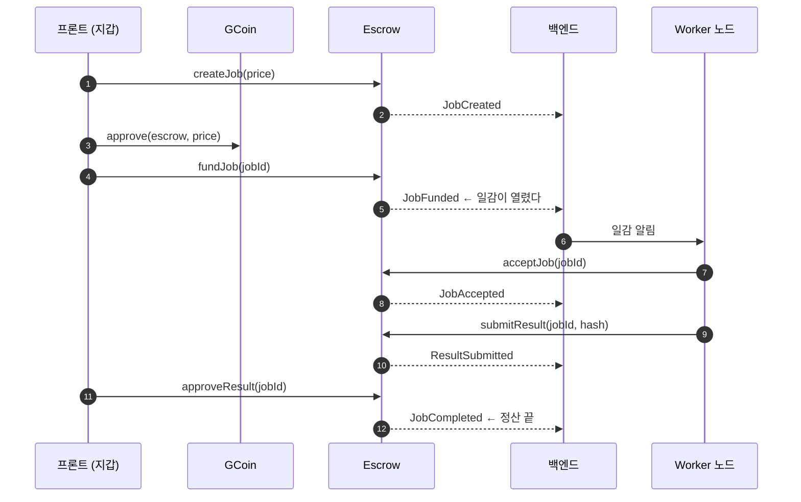

# 에스크로 연동 규격 — 백엔드·프론트용

**작성** 김상해 · 2026-09-08 · **브랜치** `bc-feature/job-escrow` · **커밋** `00f3c31`

> **주의** — 아직 SSAFY 체인에 배포되지 않았습니다. 컨트랙트 주소는 배포 후 별도로 공지합니다.
> **`createJob` 과 `acceptJob` 두 함수는 공급자 선택 정책 결정에 따라 바뀔 수 있습니다.** 나머지 다섯은 확정입니다.

---

## 0. 한 장 요약



**프론트는 지갑으로 트랜잭션을 보내고, 백엔드는 이벤트를 구독합니다.** 백엔드가 사용자 대신 서명하지 않습니다.

---

## 1. 상태

| 값 | 이름 | 뜻 |
|---:|---|---|
| 0 | `NONE` | 없는 작업 |
| 1 | `CREATED` | 등록만 됨. 돈이 안 들어옴 |
| 2 | `FUNDED` | 대금이 잠김. **일감이 열린 상태** |
| 3 | `ASSIGNED` | 공급자가 잡음 |
| 4 | `SUBMITTED` | 결과 해시가 봉인됨 |
| 5 | `COMPLETED` | 공급자에게 지급 완료 |
| 6 | `CANCELLED` | 의뢰자에게 환불 완료 |

**ABI 에서는 `uint8` 로 나옵니다.** 프론트·백엔드에 숫자를 그대로 박지 말고 공통 상수로 관리해 주십시오.

종료 상태는 `COMPLETED` 와 `CANCELLED` 둘입니다.

---

## 2. 함수 7개

### 프론트가 지갑으로 호출하는 것

| 함수 | 호출자 | 상태 | 토큰 |
|---|---|---|---|
| `createJob(uint256 price) → uint256` | 의뢰자 | → `CREATED` | 없음 |
| `fundJob(uint256 jobId)` | 의뢰자 | `CREATED` → `FUNDED` | **의뢰자 → 에스크로** |
| `cancelJob(uint256 jobId)` | 의뢰자 | `FUNDED` → `CANCELLED` | **에스크로 → 의뢰자** |
| `approveResult(uint256 jobId)` | 의뢰자 | `SUBMITTED` → `COMPLETED` | **에스크로 → 공급자** |

### 공급자 노드가 호출하는 것

| 함수 | 호출자 | 상태 | 토큰 |
|---|---|---|---|
| `acceptJob(uint256 jobId)` | 공급자 | `FUNDED` → `ASSIGNED` | 없음 |
| `submitResult(uint256 jobId, bytes32 resultHash)` | 배정된 공급자 | `ASSIGNED` → `SUBMITTED` | 없음 |

### 누구나 호출할 수 있는 것

| 함수 | 호출자 | 상태 | 토큰 |
|---|---|---|---|
| `settleTimeout(uint256 jobId)` | **누구나** | 아래 표 참고 | 상태에 따라 |

```
FUNDED    시한 경과  →  CANCELLED   의뢰자 환불
ASSIGNED  시한 경과  →  CANCELLED   의뢰자 환불
SUBMITTED 시한 경과  →  COMPLETED   공급자 지급
```

**호출자는 `jobId` 만 넘깁니다.** 수령자·금액·방향을 지정할 수 없습니다. 컨트랙트가 상태로 결정합니다.

### 조회 함수

```solidity
jobs(uint256) → (address client, uint8 state, uint64 deadline,
                 address provider, uint256 price, bytes32 resultHash)
nextJobId()        → uint256
paymentToken()     → address
acceptTimeout()    → uint64
executionTimeout() → uint64
approvalTimeout()  → uint64
```

---

## 3. 예치는 트랜잭션 두 번입니다 — 프론트 필독

**ERC-20 에는 밀어넣기가 없습니다.** 에스크로가 의뢰자 잔액에서 끌어오려면 먼저 한도를 열어 줘야 합니다.

```
1) token.approve(escrowAddress, price)   ← GCoin 컨트랙트에 보낸다
2) escrow.fundJob(jobId)                 ← 에스크로에 보낸다
```

**1번을 건너뛰면 2번이 실패합니다.** 사용자에게는 서명 창이 두 번 뜹니다.

작업 하나를 맡기는 데 서명이 **세 번**(`createJob`·`approve`·`fundJob`) 필요합니다. 화면에서 진행 단계를 보여 주는 편이 좋습니다.

`approve` 금액은 **정확히 `price` 만큼**을 권합니다. 무한 승인은 컨트랙트에 문제가 생겼을 때 잔액 전체가 위험해집니다.

---

## 4. 이벤트 7종 — 백엔드 필독

| 이벤트 | 인자 |
|---|---|
| `JobCreated` | `uint256 indexed jobId`, `address indexed client`, `uint256 price` |
| `JobFunded` | `uint256 indexed jobId`, `uint256 price`, `uint64 deadline` |
| `JobAccepted` | `uint256 indexed jobId`, `address indexed provider`, `uint64 deadline` |
| `ResultSubmitted` | `uint256 indexed jobId`, `address indexed provider`, `bytes32 resultHash`, `uint64 deadline` |
| `JobCompleted` | `uint256 indexed jobId`, `address indexed provider`, `uint256 payout` |
| `JobCancelled` | `uint256 indexed jobId`, `address indexed client`, `uint256 refund` |
| `JobTimedOut` | `uint256 indexed jobId`, `uint8 fromState` |

`jobId` 는 전부 `indexed` 라 작업 하나만 골라 구독할 수 있습니다.

### 어느 이벤트에 무엇을 하나

| 이벤트 | 백엔드가 할 일 |
|---|---|
| `JobCreated` | 작업 레코드 생성. 아직 일감 아님 |
| **`JobFunded`** | **일감을 노드에 알린다.** 돈이 잠긴 시점이라 여기서부터 실제 작업 |
| `JobAccepted` | 배정 기록. `deadline` 을 키퍼 대기열에 넣는다 |
| `ResultSubmitted` | 결과 수령 알림. **의뢰자에게 승인 요청과 만료 예정을 알린다** |
| `JobCompleted` | 정산 완료 처리 |
| `JobCancelled` | 환불 완료 처리 |
| `JobTimedOut` | **종료 사유를 구분한다.** 아래 참고 |

### `JobTimedOut` 이 짝으로 나옵니다

```
의뢰자 취소      JobCancelled 만
시한 만료 환불   JobCancelled + JobTimedOut(fromState = 2 또는 3)
정상 승인 지급   JobCompleted 만
시한 만료 지급   JobCompleted + JobTimedOut(fromState = 4)
```

**`JobCancelled` 만 보면 취소인지 만료인지 구분이 안 됩니다.** `JobTimedOut` 이 함께 왔는지로 판단하고, `fromState` 로 어느 단계에서 끝났는지 알 수 있습니다.

### 시각과 블록 번호

이벤트 본문에 시각 필드를 넣지 않았습니다. **로그에 블록 번호와 트랜잭션 해시가 자동으로 딸려 오기 때문입니다.** 시각은 그 블록에서 읽으면 됩니다.

```java
// 이벤트 로그에서
BigInteger blockNumber = log.getBlockNumber();
String     txHash      = log.getTransactionHash();

// 블록에서 시각 (유닉스 초)
BigInteger timestamp = web3j
    .ethGetBlockByNumber(DefaultBlockParameter.valueOf(blockNumber), false)
    .send().getBlock().getTimestamp();
```

#### 어느 시각을 어떻게 얻나

| 알고 싶은 것 | 방법 |
| --- | --- |
| 작업 생성 시각 | `JobCreated` 가 실린 블록 |
| 예치 시각 | `JobFunded` 가 실린 블록. 또는 `deadline - acceptTimeout` |
| **공급자 수락 시각** | `JobAccepted` 가 실린 블록. 또는 `deadline - executionTimeout` |
| **결과 제출 시각** | `ResultSubmitted` 가 실린 블록. 또는 `deadline - approvalTimeout` |
| 지급 · 환불 시각 | `JobCompleted` · `JobCancelled` 가 실린 블록 |
| 시한 만료 정리 시각 | `JobTimedOut` 이 실린 블록 |

`deadline` 이 실려 오는 이벤트는 `JobFunded` · `JobAccepted` · `ResultSubmitted` 셋뿐입니다. 나머지는 블록에서 읽어야 합니다.

#### 블록 시각의 성질

- 단위는 **유닉스 초** 입니다. 밀리초가 아닙니다.
- 같은 블록에 담긴 트랜잭션은 **시각이 모두 같습니다.**
- 컨트랙트가 기한을 검사할 때 쓰는 `block.timestamp` 와 **같은 값**입니다. 백엔드가 이 값으로 판정하면 컨트랙트와 결과가 어긋나지 않습니다.
- 앞 블록보다 커야 한다는 규칙만 있고 실제 시계와 정확히 일치하지는 않습니다. 초 단위 정밀도가 필요한 용도에는 쓰지 마십시오.

### 작업 시간을 재려는 경우 - 자주 하는 오해

`JobAccepted` 와 `ResultSubmitted` 의 시각 차이는 **GPU 가 실제로 돌아간 시간이 아닙니다.**

```
acceptJob 트랜잭션        공급자가 "맡겠습니다" 라고 서명한 시각
   |
   |   컨테이너 내려받기 · 데이터셋 준비 · 큐 대기
   v
실제 GPU 실행 시작        체인은 모릅니다
   v
실제 GPU 실행 종료        체인은 모릅니다
   |
   |   결과 업로드 · 해시 계산 · 트랜잭션 전송 대기
   v
submitResult 트랜잭션     공급자가 "다 했습니다" 라고 서명한 시각
```

두 시각의 차이는 실행 시간의 **상한**입니다. 준비와 업로드가 포함되어 있어 실제 연산 시간보다 깁니다.

| 용도 | 어디가 원본인가 |
| --- | --- |
| 기한을 넘겼는지 판정 | **온체인.** 컨트랙트가 직접 검사합니다 |
| 정산 근거 · 분쟁 시 증거 | **온체인.** 이벤트와 블록이 증거입니다 |
| 실제 GPU 실행 시간 | **오프체인 DB.** 체인에 없습니다 |
| 공급자 성능 통계 · 과금 | **오프체인 DB** |

#### 실행 시각을 온체인에 올리지 않은 이유

**공급자가 스스로 신고하는 값은 아무도 검증할 수 없기 때문입니다.** 온체인 기록의 가치는 제3자가 검증할 수 있다는 데 있는데, 자기 신고 시각은 그 성질을 갖지 못합니다. 반면 트랜잭션이 담긴 블록의 시각은 네트워크가 보증하므로 조작하기 어렵습니다.

또한 지금 정산은 `createJob(price)` 로 정한 **고정 금액**입니다. 전액을 주거나 전액을 돌려줄 뿐이라 실행 시간이 금액에 영향을 주지 않습니다.

**시간당 과금으로 바뀌면 이 설계를 다시 봐야 합니다.** 그때는 실행 시간이 정산 근거가 되므로 검증 가능한 형태로 온체인에 올려야 합니다.

### 재구독 시 주의

노드가 재시작하면 놓친 이벤트가 생깁니다. **마지막으로 처리한 블록 번호를 저장해 두고 거기서부터 다시 읽어야 합니다.** 확정 대기 블록도 몇 개 두는 편이 안전합니다.

---

## 5. 시한과 키퍼

시한은 배포 시점에 정하는 고정값 셋입니다.

| 상태 | 시한 | 시작 시점 | 만료 시 |
|---|---|---|---|
| `FUNDED` | `acceptTimeout` | `fundJob` 성공 | 의뢰자 환불 |
| `ASSIGNED` | `executionTimeout` | `acceptJob` 성공 | 의뢰자 환불 |
| `SUBMITTED` | `approvalTimeout` | `submitResult` 성공 | 공급자 지급 |

**만료 시각은 이벤트의 `deadline` 인자로 옵니다.** 조회하지 않아도 구독만으로 알 수 있습니다.

### 컨트랙트는 스스로 움직이지 않습니다

시한이 지나도 **아무 일도 일어나지 않습니다.** 누군가 `settleTimeout(jobId)` 을 보내야 합니다.

**백엔드 키퍼가 이 일을 맡아야 합니다.**

```
1. 종료되지 않은 작업과 deadline 을 보관한다
2. 현재 시각이 deadline 을 넘긴 작업을 찾는다
3. settleTimeout(jobId) 을 보낸다
4. 영수증과 JobTimedOut 이벤트를 저장한다
5. 이미 남이 처리한 작업의 revert 는 정상으로 취급한다
```

**5번이 중요합니다.** 누구나 부를 수 있어서 사용자가 먼저 처리했을 수 있습니다. 그때 `"Escrow: not settleable"` 로 되돌아오는데 오류가 아닙니다.

SSAFY 체인은 가스가 0 이라 운영비 부담은 없습니다.

---

## 6. 경계 규칙 — 프론트가 알아야 할 것

정상 함수와 만료 정산은 **유효 구간이 겹치지 않습니다.**

| 블록 시각 | `acceptJob`·`submitResult` | `settleTimeout` |
|---|---|---|
| 시한 이하 | 가능 | 실패 |
| 시한 초과 | 실패 | 가능 |

**공급자가 시한 직전에 제출하면 실패할 수 있습니다.** 트랜잭션이 대기열에서 밀려 다음 블록에 담기면 이미 시한이 지납니다.

화면에서 **남은 시간을 보여 주고 마감 직전 제출을 막는 편**이 좋습니다.

---

## 7. 되돌림 사유

| 오류 | 언제 |
|---|---|
| `DeadlineExpired()` | 시한이 지난 뒤에 정상 함수를 불렀다 |
| `DeadlineNotReached()` | 시한 전에 `settleTimeout` 을 불렀다 |
| `SafeERC20FailedOperation(address token)` | 토큰 전송이 실패했다 |
| `ReentrancyGuardReentrantCall()` | 재진입이 차단됐다 |
| `SsafyDeploymentBlocked()` | **배포 시에만** 발생. 정책 확정 후 제거 예정 |

문자열로 오는 것들도 있습니다.

```
"Escrow: not the client"        의뢰자가 아니다
"Escrow: not the provider"      배정된 공급자가 아니다
"Escrow: client cannot accept"  의뢰자는 자기 작업을 못 잡는다
"Escrow: not FUNDED"            상태가 맞지 않는다
"Escrow: not ASSIGNED"          같음
"Escrow: not SUBMITTED"         같음
"Escrow: not CREATED"           같음
"Escrow: not settleable"        종료된 작업이거나 대기 상태가 아니다
"Escrow: price is zero"         가격이 0 이다
"Escrow: empty result hash"     결과 해시가 비었다
```

---

## 8. 온체인에 없는 것

```
workloadId · imageDigest · datasetHash · 결과 파일 위치 · 진행률
실제 GPU 실행 시작 시각 · 실행 종료 시각
```

**전부 오프체인 DB 가 원본입니다.** 컨트랙트는 정산에 필요한 것만 들고 있습니다.

실행 시각이 여기 들어가는 이유는 4절 "작업 시간을 재려는 경우" 에 적었습니다. 요약하면, 체인에 남는 것은 **공급자가 서명한 시각**이지 연산이 돌아간 시각이 아닙니다.

`resultHash` 는 **"공급자가 이 결과를 냈다" 는 서명**이지 결과가 올바르다는 증명이 아닙니다. 실제 검증은 의뢰자가 결과 파일을 받아 해시를 대조하는 방식으로 오프체인에서 합니다.

---

## 9. MVP 신뢰 가정 — 반드시 읽어 주십시오

**의뢰자가 승인 기한 안에 응답하지 않으면 공급자가 자동으로 지급받습니다.**

잘못된 결과의 해시를 올려도 마찬가지입니다. 컨트랙트는 GPU 가 돌았는지 볼 수 없습니다.

그래서 프론트와 백엔드가 이 둘을 해 주셔야 합니다.

1. **결과 제출 알림** — `ResultSubmitted` 를 받으면 의뢰자에게 알린다
2. **만료 예정 알림** — 승인 시한이 다가오면 다시 알린다

결과 거절과 분쟁, 중재는 후속 작업입니다. **실제 가치가 걸린 결제에 쓰기 전에 반드시 추가해야 합니다.**

---

## 10. 아직 정해지지 않은 것

| 항목 | 영향받는 것 |
|---|---|
| **공급자 선택 정책** | `createJob` 인자, `acceptJob` 권한 |
| 작업별 실행 시간 | `executionTimeout` 이 고정인지 작업마다 다른지 |
| 공급자 노드 서명 방식 | 노드가 `acceptJob`·`submitResult` 를 어떻게 보내나 |
| 키퍼 담당 | `settleTimeout` 을 누가 돌리나 |
| GSC 배분 | 시연 계정에 잔액을 어떻게 넣나 |

**나머지 다섯 함수와 이벤트 일곱은 확정입니다.** 그 부분부터 붙이셔도 됩니다.

ABI 파일은 배포 시점에 확정본을 드리겠습니다. 그전에 미리 필요하시면 말씀해 주십시오.
