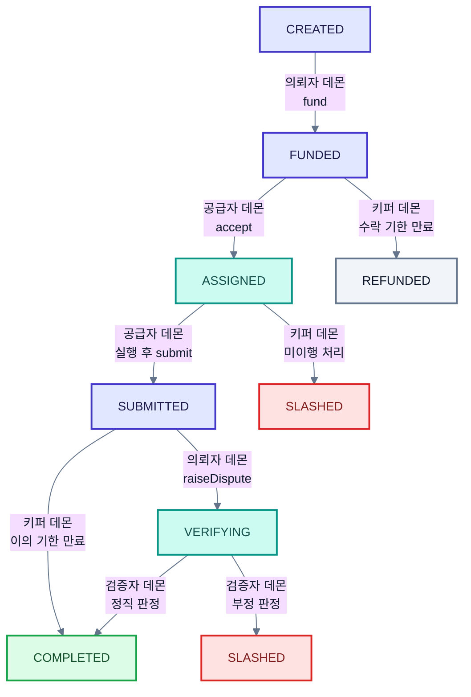

# P2P 노드 런타임 학습 기록

---

## 1. 역할의 경계

### P2P는 네트워크 계층이 아니다

노드끼리 직접 통신하지 않는다. 체인을 통해서만 만난다. 의뢰자가 체인에 일감을 쓰면 공급자는 그것을 읽다가 발견해 수락을 쓴다. 둘은 한 번도 서로에게 말을 걸지 않는다.

내 산출물에는 다음이 없다.

- 소켓
- IP 주소
- 노드 디스커버리
- libp2p
- NAT traversal

여기에 매달리면 4주가 통째로 사라진다.

### 만드는 것

`nodes/` 파이썬 데몬 5종이다. 골격은 `이벤트 구독 → 조건 판단 → 트랜잭션 전송`으로 모두 같다.

| 노드 | 하는 일 |
|---|---|
| 공급자 | 일감 감시 → 수락 → 실행 → 결과 봉인 → 제출 |
| 검증자 | 검사 대상 수신 → 재실행 → 비교 → 판정 제출 |
| 의뢰자 | 등록 → 결과 수령 → 자가 표본 검사 → 이의 제기 |
| 키퍼 | 기한이 지난 작업을 대신 종료 |
| 부정 노드 | 공급자 노드에 플래그 하나를 더한 것 |

### 파이썬은 선택이 아니라 제약이다

표면적 이유는 AI 담당의 `kernel/`을 `import` 해야 해서다. 진짜 이유는 따로 있다.

GPU 연산은 같은 입력에도 결과가 미세하게 달라진다. 판정은 해시 일치가 아니라 유사도와 임계값으로 한다. 공급자가 파이썬으로 돌리고 검증자가 자바로 돌리면 정직한 두 노드의 오차가 GPU 차이보다 크게 벌어진다.

> 공급자와 검증자가 같은 코드를 돌려야 결과 차이의 원인이 부정 하나로 좁혀진다. 원인이 둘 이상이면 판정 자체가 성립하지 않는다.

---

## 2. 조사해서 알게 된 것

### 컨트랙트는 스스로 움직이지 않는다

크론도 타이머도 없다. 누군가 트랜잭션을 보내야만 상태가 바뀐다.

- "2분 뒤 자동 승인"은 자동이 아니다
- 2분이 지난 뒤 누군가 호출해야 승인된다
- 아무도 호출하지 않으면 자금이 영원히 잠긴다

키퍼 데몬은 오로지 이 때문에 존재한다.

### 타임아웃 전이는 누구나 호출한다

어떤 대기 상태든 그 전이로 손해 보는 쪽이 있다. 그 사람에게 권한을 맡기면 영원히 호출하지 않는다.

권한을 열어도 안전한 이유는 컨트랙트가 조건을 검사하기 때문이다. 기한이 안 지났으면 튕겨내고 지났으면 누가 눌러도 결과가 같다.

### 검사 대상 선정은 제출 이후다

미리 공지하면 공급자가 그 부분만 정직하게 계산한다. 계산해 봉인하고 제출한 뒤에 선정해야 공급자가 어디가 걸릴지 모르는 채로 내놓는다.

부정 노드가 재현할 공격이 바로 이것이다.

### 커서는 로컬에 저장한다

체인은 알림을 보내주지 않는다. 노드가 계속 다시 읽는다. 어디까지 읽었는지는 순전히 내 사정이라 체인에 쓰지 않는다.

- 쓰기에 가스비가 든다
- 남이 알 필요가 없다
- 재시작하면 로컬 파일에서 커서를 읽어 이어 읽는다

### 재현 가능한 것에만 값을 매긴다

| 값 | 재현 | 판단 |
|---|---|---|
| 결과 벡터 | 가능 | 누구나 다시 계산해서 확인한다 |
| 소요 시간 | 불가 | 정말 3시간 걸렸는지 알 방법이 없다 |
| GPU 등급 | 불가 | 등록 시 벤치마크는 한때 빨랐다만 증명한다 |

재현할 수 없는 것에 값을 매기면 관측자를 믿어야 한다. 그것이 오라클 문제다.

같은 이유로 AI는 조언까지만 한다. AI가 부정이라고 판정해 자금을 움직이면 그 순간 오라클이 된다.

### 학습은 과정이 아니라 결과를 검증한다

추론은 1,000건이 서로 무관해서 17번만 따로 재실행할 수 있다. 학습은 다르다.

- 스텝 `t`가 `t−1`에 의존해 표본 재실행이 성립하지 않는다
- 손실값은 그럴듯한 숫자를 지어내면 그만이다

계약 조건을 바꾼다.

- 이 데이터로 학습시켜 달라 → 잠긴 시험지에서 원본 모델보다 점수가 높은 어댑터를 납품하라

시험지 풀이는 추론이라 누구나 다시 돌려볼 수 있다. 목표는 절대값이 아니라 원본 모델과 견준 값으로 둔다. 그래야 기준선이 명확해진다.

시험지를 미리 주면 학습 데이터에 섞어버린다. 공개는 나중으로 미룬다. 검사할 내용을 미리 알려주지 않는다는 원칙이 시험지 공개와 검사 문항 선정에서 두 번 적용된다.

---

## 3. 상태 흐름과 데몬의 위치

각 전이마다 어느 데몬이 트랜잭션을 쏘는지 붙여서 다시 그렸다.



| 상태 | 감시 데몬 | 판단 근거 | 트랜잭션 |
|---|---|---|---|
| `CREATED` | 의뢰자 | 내가 등록한 작업인가 | `fund` |
| `FUNDED` | 공급자 | 조건이 내 GPU에 맞고 아직 안 잡혔나 | `accept` |
| `FUNDED` | 키퍼 | 수락 기한이 지났나 | 환불 처리 |
| `ASSIGNED` | 공급자 | 내가 잡은 작업인가 | 실행 후 `submit` |
| `ASSIGNED` | 키퍼 | 제출 기한이 지났나 | 미이행 처리 |
| `SUBMITTED` | 의뢰자 | 자가 표본 검사가 어긋나나 | `raiseDispute` |
| `SUBMITTED` | 키퍼 | 이의 기한이 지났나 | 자동 승인 |
| `VERIFYING` | 검증자 | 내가 검증자로 뽑혔나 | 재실행 후 판정 제출 |
| `VERIFYING` | 키퍼 | 검증 기한이 지났나 | 기한 만료 처리 |

부정 노드는 공급자와 같은 자리에 서되 `submit` 내용만 조작한다. 별도 데몬이 아니라 플래그 하나 차이다.

종료 상태는 `COMPLETED`, `REFUNDED`, `SLASHED` 셋뿐이다.

---

## 4. 직접 한 것

### 팀 문서 2건 교차 검토

`P2P_담당_크로스체크_정리.md`와 `GPU_분산컴퓨팅_최종_아키텍처_상세보고서.md`를 `설계확정.md`와 대조했다. 정면으로 충돌하는 지점이 넷 나왔다.

| 항목 | 크로스체크 문서 | 설계확정.md |
|---|---|---|
| 배정 | Backend가 Worker를 배정 | 공급자가 선착순 수락 |
| 과금 | 시간당 가격 × 실제 사용시간 | 작업 단위 |
| 검증 | 없음 | 봉인 + 표본 + 재실행 |
| 정산 | Backend가 정산액 계산 | 컨트랙트가 판정하고 집행 |

판가름은 블록체인을 빼면 어떻게 되느냐다.

- 크로스체크 문서 쪽은 그대로 돌아간다. 보고서 31장이 그것을 스스로 인정한다
- 설계확정 쪽은 판정을 강제할 주체가 사라져 프로젝트 자체가 없어진다

블록체인 특화 트랙에서 이 차이는 결정적이다.

가져올 항목은 이렇다.

- `split` / `merge` 인터페이스
- Usage Receipt Hash
- 측정 지표 (보고서 43장)
- Model Registry와 해시 검증
- 재시도 및 재발행 경로

지켜야 할 선은 넷이다.

- 결과 과금
- 공급자 직접 수락
- 검증 유지
- 컨트랙트 판정

### 유저 플로우 초안 수정

- **AI가 GPU를 골라서 돌린다는 성립하지 않는다.** 서버는 남의 지갑에서 담보를 꺼낼 수 없어 배정에 구속력이 없다. 공급자가 스스로 잡는 방식으로 바꾼다. 화면은 그대로이고 내부 구조만 달라진다
- **로컬은 공급자의 PC다.** 우리가 운영하는 GPU 서버는 없다. 참여자의 노트북이 곧 서버다
- **블록체인과 P2P로 검증한다는 성립하지 않는다.** 블록체인은 기록하고 돈을 잠그고 풀 뿐이다. 실제 검증은 다른 사람의 컴퓨터가 다시 돌려보는 것이다

### 설계 허점 정리

| # | 허점 |
|---|---|
| 1 | 분산을 안 한다. 1단계는 작업 1개에 공급자 1명이라 여러 대가 도는 화면이 없다 |
| 2 | 성능과 비용 숫자가 없다. 안전성만 보고 효율을 한 번도 재지 않았다 |
| 3 | 실패 후 복구 경로가 없다. 공급자가 잠수하면 의뢰자는 처음부터 다시 등록해야 한다 |
| 4 | 쪼개는 규칙이 없다. Chunk 경계가 검증 정확도를 결정하는데 누가 정하는지 미정이다 |
| 5 | 자기신고 값의 변조를 못 잡는다. 미검증 표시만 하고 끝냈다 |
| 6 | 네트워크 분리 위험을 안 봤다. 노트북 6대가 같은 네트워크에 있다고 전제한다 |

1번 해결안은 계약 하나를 나누지 않고 독립 계약을 여러 개 발행한다. Job은 이미 혼자 시작해서 혼자 끝나는 완결 단위라 20개로 늘려도 컨트랙트를 안 고친다.

반대로 Chunk를 온체인 정산 단위로 삼으면 셋이 깨진다.

- 종료 상태가 정의되지 않아 잔액이 남는다
- 병합 대기에서 작업 전체가 멈춘다
- 이의 예치금이 가스비보다 싸져서 이의 제기가 성립하지 않는다

`(대금 / N) × 0.1`이 `raiseDispute` 가스비를 넘도록 `N`의 상한을 역산해야 한다.

### 워크로드 재검토

임베딩은 CPU로도 돌아가서 GPU를 쓸 이유를 설명하지 못한다. 검증 편의로 고른 워크로드이기 때문이다.

| 후보 | GPU 명분 | 검증 |
|---|---|---|
| 임베딩 (현재 확정) | 없음 | 가능하나 오차 임계값 실측이 필요하다 |
| 이미지 생성 | 강함 | 어렵다 |
| 모델 평가 (객관식 벤치마크) | 있음 | 가장 쉽다 |
| 학습 + 성능 보장 납품 | 강함 | 가능하나 난이도가 가장 높다 |

지금 가장 큰 위험은 오차 임계값이다. 재보고 창이 없으면 검증 로직 전체를 다시 짜야 한다. 객관식은 출력이 A/B/C/D라서 이 위험이 거의 사라진다.

### 워커 에이전트 실행 환경 구축

팀이 배포한 `gpu-worker-agent`가 실행 즉시 종료되어 콘솔에서 붙잡아 원인을 확인했다.

```
Worker client failed: SETUP_REQUIRED [DOCKER_UNAVAILABLE]: Docker CLI not found
```

Docker가 WSL 안에만 있어서 Windows 프로세스인 에이전트가 찾지 못했다.

- Docker Desktop 4.88.1 설치
- WSL 통합은 꺼서 기존 WSL Docker 29.6.2 보존
- GPU 통과 확인 (RTX 4050 Laptop, 6141MiB, 드라이버 591.44)

여기서 얻은 교훈이 셋이다.

- **컨테이너 격리는 전제 조건이다.** 이 에이전트는 Docker가 없으면 경고에 그치지 않고 아예 시작을 거부한다. 남의 코드를 자기 GPU에서 돌려주는 구조이기 때문이다. 내 공급자 데몬도 같은 판단을 해야 한다
- **연산 커널은 컨테이너에 위임한다.** 번들의 외부 의존성이 `websockets` 하나뿐인 얇은 상주 프로그램이었다. 내 데몬 골격이 가야 할 방향과 같다
- **GPU 인벤토리 1대분을 확보했다.** VRAM 6GB는 7B급 모델을 온전히 올리기에 부족하다. 워크로드 선택에 실제 제약으로 작용한다

---

## 5. 팀에 올릴 안건

| # | 안건 | 왜 지금인가 |
|---|---|---|
| 1 | 크로스체크 문서와 `설계확정.md` 중 무엇이 살아 있나 | 두 설계는 양립할 수 없다. 2일차 ABI가 어느 쪽이냐에 따라 4주가 갈린다 |
| 2 | 배정 방식이 서버 배정인가 공급자 선착순인가 | 상태 기계와 자금 흐름이 전부 여기서 갈린다 |
| 3 | 워크로드를 임베딩에서 모델 평가로 교체 | 코드가 0줄인 지금이 가장 싸다 |
| 4 | 독립 작업 여러 개로 발행 | 분산을 보여주면서 검증도 유지하고 컨트랙트를 안 고친다 |
| 5 | 역할 이름을 노드 런타임으로 변경 | P2P 담당이라는 이름이 계속 오해를 만든다 |
| 6 | 측정 지표 정의 | 우리에게 통째로 없어서 발표에 쓸 숫자가 없다 |

6번 지표는 다섯이다.

- 부정 탐지율
- 오탐률
- 임계값 창의 폭
- 검증 비용 대비 연산 비용
- 백엔드 정지 후 완주 여부

---

## 6. 다음에 할 것

### 작업 목록

- [ ] 팀 노트북 GPU와 VRAM 인벤토리 조사 (내 것 1대 완료, 나머지 5대)
- [ ] 위 안건 6개를 팀 회의에 올리기
- [ ] Hardhat 로컬 체인과 더미 컨트랙트로 `emit` → 구독 → 트랜잭션 전송 한 바퀴 돌려보기
- [ ] 데몬 골격 작성 (이벤트 구독 루프, 커서 저장과 복구, 키 관리, 트랜잭션 전송 래퍼)

ABI가 나오기 전에도 데몬 골격은 짤 수 있다. 학습 결과물이 그대로 1주차 산출물이 된다.

### 미결 항목

| 미결 | 왜 내 문제인가 |
|---|---|
| 오차 임계값 (실측 전) | 검증자 데몬의 판정 기준이다. 실측 전에는 코드에 숫자를 넣지 않는다 |
| 검증자 태만 | 검증자를 정직하게 짜도 프로토콜이 게으름을 못 막으면 시연이 공허해진다 |
| 데이터 미공개 공격 | 부정 노드로 재현할 시나리오다 |
| 작업 하나의 크기 | 예치금이 가스비를 넘어야 하고 데모 시간 안에 끝나야 한다 |

돈의 위치는 백엔드만 막을 뿐 내 데몬은 막지 않는다. 기다리지 않고 진행한다.

### 3주차 명제

> 백엔드를 꺼도 한 바퀴가 돈다.

백엔드 게이트웨이는 읽기 편의 계층일 뿐이다. 상태를 바꾸는 트랜잭션은 각 노드가 자기 키로 직접 보낸다. 게이트웨이가 죽어도 공급자가 체인을 직접 읽어 일감을 잡을 수 있어야 한다.

이 명제를 증명하는 주체가 내 노드다. 이 프로젝트가 중개 플랫폼 없이 돈다고 주장할 근거를 내가 만든다.
