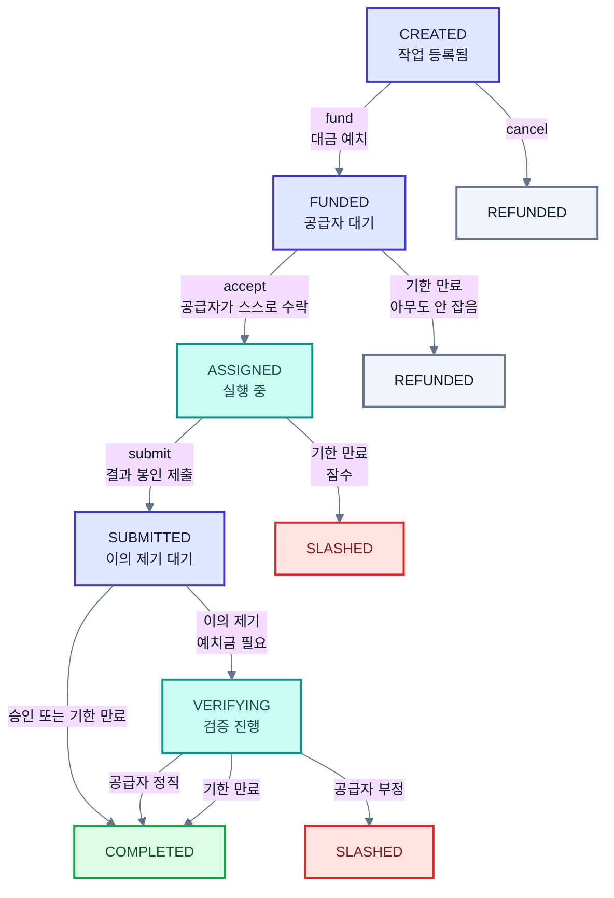
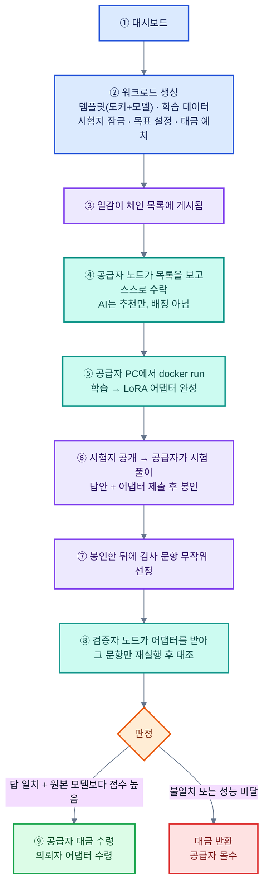
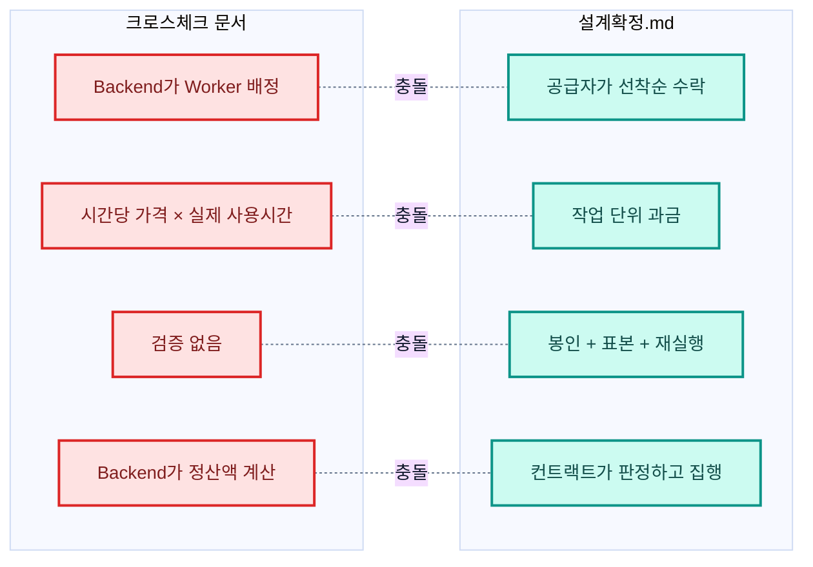
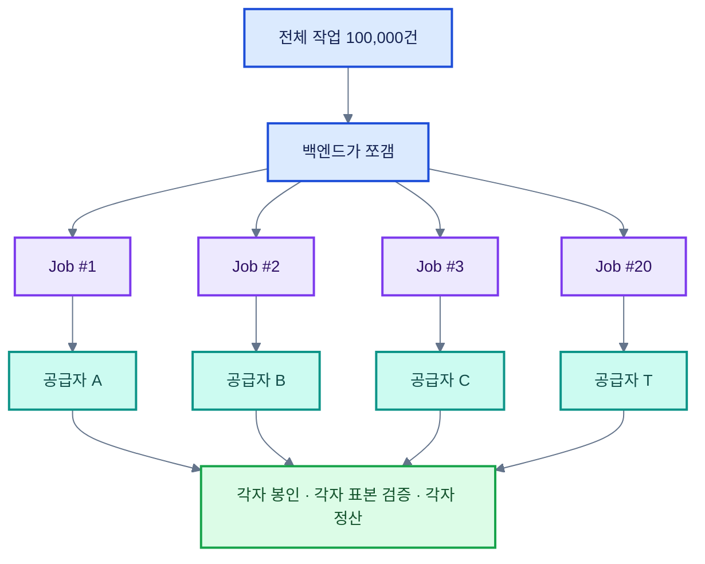

# P2P 담당 학습 정리 — 김상해

> 작성 2026-08-27 · 근거 문서는 `docs/research/`, `docs/학습계획-P2P.md`
> 이 문서는 **학습 기록이자 팀에 올릴 안건 목록**입니다.

---

## 1. 내 역할의 경계

### "P2P"는 네트워크 계층이 아니다

가장 먼저 못 박은 것입니다. 노드끼리 직접 통신하지 않고 **오직 체인을 통해서만** 만납니다.

```
(A) 노드 ──직접 메시지──> 노드      상대 주소를 알아야 합니다
(B) 노드 ──서버 경유───> 노드      중앙이 생깁니다
(C) 노드 ──> [블록체인] <── 노드    주소도 중앙도 필요 없습니다   ← 우리 방식
```

의뢰자는 체인에 일감을 쓰고, 공급자는 체인을 읽다가 발견해서 체인에 수락을 씁니다. 둘은 한 번도 서로에게 말을 걸지 않습니다.

**따라서 내 산출물에는 소켓도, IP 주소도, 노드 디스커버리도, libp2p도 없습니다.**

### 만드는 것

`nodes/` 파이썬 데몬 5종입니다. 골격은 하나로 같습니다.

```
이벤트 구독  →  조건 판단  →  트랜잭션 전송
```

| 노드 | 하는 일 |
|---|---|
| 공급자 | 일감 감시 → 수락 → 실행 → 결과 봉인 → 제출 |
| 검증자 | 검사 대상 수신 → 재실행 → 비교 → 판정 제출 |
| 의뢰자 | 등록 → 결과 수령 → 자가 표본 검사 → 이의 제기 |
| 키퍼 | 기한이 지난 작업을 대신 종료시킴 |
| 부정 노드 | 공급자 노드에 플래그 하나를 더한 것 |

### 만들지 않는 것

libp2p, NAT traversal, 노드 디스커버리, 컨테이너 오케스트레이션입니다. 여기에 매달리면 4주가 통째로 사라집니다.

### 파이썬인 이유는 제약이지 선택이 아니다

표면적 이유는 AI 담당의 `kernel/`을 `import` 해야 하기 때문입니다. 진짜 이유는 따로 있습니다.

GPU 연산은 같은 입력을 넣어도 결과가 미세하게 달라집니다. 그래서 우리는 해시 일치가 아니라 **유사도 + 임계값**으로 판정합니다. 그런데 공급자가 파이썬으로 돌리고 검증자가 자바로 돌리면, 라이브러리 구현 차이 때문에 **정직한 두 노드 사이의 오차가 GPU 차이보다 더 크게 벌어집니다.**

> 공급자와 검증자가 같은 코드를 돌려야, 결과 차이의 원인이 "부정" 하나로 좁혀집니다. 원인이 둘 이상이면 판정 자체가 성립하지 않습니다.

---

## 2. 오늘 확실히 이해한 개념 다섯

### ① 컨트랙트는 스스로 움직이지 않는다

크론도 타이머도 없습니다. 누군가 트랜잭션을 보내야만 상태가 바뀝니다.

"2분 뒤 자동 승인"은 자동이 아닙니다. 2분이 지난 뒤 **누군가 호출해야** 승인됩니다. 아무도 호출하지 않으면 자금은 영원히 잠깁니다.

**이것이 키퍼 데몬이 존재하는 이유 전체입니다.**

### ② 타임아웃 전이는 누구나 호출할 수 있어야 한다

어떤 대기 상태든 그 전이로 손해 보는 쪽이 있고, 그 사람에게 호출 권한을 맡기면 영원히 호출하지 않습니다.

권한을 열어도 안전한 이유는 **컨트랙트가 조건을 검사하기 때문**입니다. 기한이 안 지났으면 튕겨내고, 지났으면 누가 눌러도 결과가 같습니다.

### ③ 검사 대상 선정은 결과 제출 이후여야 한다

```
❌ 검사 대상 공지 → 계산 → 제출        공급자가 그 부분만 정직하게 계산합니다
⭕ 계산 → 제출·봉인 → 그 다음에 선정    어디가 걸릴지 모르는 채로 제출합니다
```

내가 만들 **부정 노드가 바로 이 공격을 재현하는 물건**입니다.

### ④ 커서는 내 컴퓨터에 저장한다

체인은 알림을 보내주지 않으므로 노드가 계속 다시 읽습니다. "어디까지 읽었는지"는 순전히 내 사정이므로 체인에 쓰지 않습니다. 쓰기에는 가스비가 들고, 남이 알 필요도 없습니다.

노드가 꺼졌다 켜지면 로컬 파일에서 커서를 읽어 그 지점부터 이어 읽습니다.

### ⑤ 재현 가능한 것에만 값을 매긴다

이것이 오늘 얻은 가장 큰 원칙입니다.

```
결과 벡터   재현 가능  →  누구나 다시 계산해서 확인할 수 있습니다
소요 시간   재현 불가  →  공급자 GPU에서 정말 3시간 걸렸는지 알 방법이 없습니다
GPU 등급    재현 불가  →  등록 시 벤치마크는 "한때 빨랐다"만 증명합니다
```

재현할 수 없는 값에 값을 매기면 **관측자를 믿어야 하고, 그것이 오라클 문제**입니다. 우리 설계가 오라클을 쓰지 않는 이유가 여기 있습니다.

같은 이유로 **AI는 조언까지만 합니다.** AI가 "부정이다"라고 판정해서 자금을 움직이면 AI가 곧 오라클이 됩니다.

---

## 3. 상태 흐름



**종료 상태는 셋뿐입니다.**

| 상태 | 뜻 |
|---|---|
| `COMPLETED` | 정상 이행으로 종결되었습니다 |
| `REFUNDED` | 아무도 수락하지 않아 환불되었습니다 |
| `SLASHED` | 이행 실패 또는 부정으로 종결되었습니다 |

---

## 4. 유저 플로우 (학습 워크로드 기준 수정안)

내가 그린 초안을 오늘 대화로 고친 것입니다.



| 색 | 담당 |
|---|---|
| 파랑 | 화면 (프론트) |
| 보라 | 블록체인 (컨트랙트) |
| 청록 | **내 노드 데몬** |
| 주황 | 판정 분기 |

### 초안에서 고친 것 세 가지

**① "AI가 GPU를 골라서 돌린다"는 성립하지 않습니다.**
서버는 남의 지갑에서 담보를 꺼낼 수 없으므로 배정에 구속력이 없습니다. 배정 대신 **공급자가 목록을 보고 스스로 잡는 방식**으로 바꿉니다. 화면에서는 차이가 안 보이고, 내부 구조만 달라집니다.

**② "로컬"은 공급자의 PC입니다.**
우리가 운영하는 GPU 서버는 없습니다. 참여자의 노트북이 곧 서버입니다.

**③ "블록체인·P2P로 검증한다"는 성립하지 않습니다.**
블록체인은 검증하지 않습니다. 기록하고, 돈을 잠그고 풀고, 규칙을 강제할 뿐입니다. **실제 검증은 다른 사람의 컴퓨터가 다시 돌려보는 것**입니다.

### 계층별로 하는 일

| 단계 | 화면 | 블록체인 | 파일 전송 | 실제 연산 |
|---|---|---|---|---|
| ② 생성·예치 | 입력 | **돈 잠금** | 데이터 업로드 | |
| ④ 수락 | 목록 | **수락 기록** | | |
| ⑤ 학습 | 진행률 | | 데이터 수신 | **학습** |
| ⑥ 제출 | | **봉인 기록** | 어댑터 업로드 | 시험 풀이 |
| ⑦ 선정 | | **문항 추첨** | | |
| ⑧ 검증 | | **판정 기록** | 어댑터 수신 | **재실행** |
| ⑨ 정산 | 결과 | **대금 지급** | 어댑터 수령 | |

---

## 5. 학습 워크로드를 다룰 수 있는가

### 결론

**학습 과정은 검증할 수 없습니다. 그러나 학습 결과물의 성능은 검증할 수 있습니다.**

| | 추론 | 학습 |
|---|---|---|
| 항목 독립성 | 1,000건이 서로 무관합니다 | 스텝 `t`가 `t−1`에 의존합니다 |
| 표본 재실행 | 17번만 따로 돌릴 수 있습니다 | 그 시점의 전체 가중치가 필요합니다 |
| 오차 | 추론 1회라 누적이 없습니다 | 스텝마다 누적·증폭됩니다 |
| 위조 난이도 | 벡터를 지어내면 유사도로 걸립니다 | **손실값은 그럴듯한 숫자를 적으면 그만입니다** |

그래서 계약 조건을 바꿉니다.

```
❌ "이 데이터로 학습시켜 주세요"
⭕ "이 데이터로 학습시켜서, 잠긴 시험지에서 원본 모델보다 점수가 높은 어댑터를 납품하세요"
```

**시험지를 푸는 것은 추론이므로 누구나 다시 돌려볼 수 있습니다.**

### 목표를 절대값이 아니라 비교값으로

"정확도 80% 이상"은 좋지 않습니다. 달성 가능한 수치인지 등록 시점에 아무도 모르기 때문입니다.

**"학습 안 한 원본 모델보다 점수가 높을 것"** 으로 하면 기준선이 명확해집니다. 원본 점수는 누구나 직접 잴 수 있습니다.

### 이러면 부정 공격 두 가지가 모두 잡힙니다

| 공격 | 잡는 방법 |
|---|---|
| 학습을 안 하고 원본 그대로 납품 | 점수가 원본과 같으므로 **성능 기준**에 걸립니다 |
| 실제 70%인데 85%라고 부풀려 신고 | 검증자가 재실행해서 답을 대조하므로 **봉인·표본 검증**에 걸립니다 |

**부정 노드는 이 둘을 그대로 재현하면 됩니다.**

### 시험지를 나중에 공개하는 이유

미리 주면 공급자가 시험 문제를 학습 데이터에 섞어버립니다. 점수는 잘 나오지만 쓸모없는 모델이 나옵니다.

**"검사할 내용을 미리 알려주지 않는다"** 는 원칙이 두 번 적용됩니다. 시험지 공개 시점에서 한 번, 검사 문항 선정에서 한 번입니다.

### 분산 학습은 우리 환경에서 안 됩니다

| 형태 | 판정 | 이유 |
|---|---|---|
| 한 대에서 LoRA 파인튜닝 | 가능합니다 | 통신이 없습니다 |
| 소형 모델 + LoRA + 같은 공유기 | 돌기는 합니다 | 스텝당 수 MB 교환입니다 |
| 7B급 + 인터넷 | 불가능합니다 | 통신이 연산의 5~10배입니다 |
| 전체 파인튜닝 | 불가능합니다 | 스텝당 십수 GB입니다 |
| 텐서·파이프라인 병렬 | 불가능합니다 | 레이어마다 주고받아야 합니다 |

**돌아가는 것과 빨라지는 것은 다릅니다.** 학습은 6대를 붙이면 오히려 느려지므로, 분산의 이득을 화면에 보여줄 수 없습니다. 반면 추론은 대수만큼 선형으로 빨라집니다.

---

## 6. 팀 문서 두 건 검토 결과

팀에서 받은 크로스체크 문서 두 건을 `설계확정.md`와 대조했습니다.

### 대상

1. `P2P_담당_크로스체크_정리.md`
2. `GPU_분산컴퓨팅_최종_아키텍처_상세보고서.md`

### 정면 충돌하는 지점



### 결정적 시험

| | 블록체인을 빼면 |
|---|---|
| 크로스체크 문서 | **돌아갑니다.** 보고서 31장이 스스로 인정합니다 |
| 설계확정.md | **프로젝트가 사라집니다.** 판정을 강제할 주체가 없어집니다 |

SSAFY **블록체인 특화** 트랙에서 이 차이는 결정적입니다.

### 그쪽 문서에서 가져올 것

| 항목 | 어디에 쓰나 |
|---|---|
| `split` / `merge` 인터페이스 | 우리 `WorkloadExecutor`에 없습니다. 쪼개는 규칙이 검증 정확도를 결정합니다 |
| Usage Receipt Hash | 자기신고 값(진행률·소요시간)의 사후 변조를 잡습니다 |
| 측정 지표 (보고서 43장) | 우리에게 통째로 없습니다 |
| Model Registry + 캐시 + 해시 검증 | 우리 모델 신원 확인을 보강합니다 |
| 재시도·재발행 | 우리에게 실패 후 복구 경로가 없습니다 |

### 지켜야 할 선

| | 왜 |
|---|---|
| **결과 과금** (시간 과금 아님) | 시간은 재현 검증이 불가능하므로 오라클이 필요해집니다 |
| **공급자가 직접 수락** (서버 배정 아님) | 서버는 남의 지갑에서 담보를 꺼낼 수 없습니다 |
| **검증 유지** | 블록체인과 AI를 쓰는 이유가 둘 다 여기 걸려 있습니다 |
| **컨트랙트가 판정** (백엔드 오라클 아님) | 오라클을 넣으면 신뢰가 서버로 옮겨갑니다 |

---

## 7. 우리 설계의 허점 (그쪽 문서가 드러낸 것)

정직하게 인정할 부분입니다.

| # | 허점 | 내용 |
|---|---|---|
| 1 | **분산을 안 합니다** | 1단계는 작업 1개에 공급자 1명입니다. 여러 대가 도는 화면이 없습니다 |
| 2 | **성능·비용 숫자가 없습니다** | 안전성만 측정하고 효율을 한 번도 재지 않았습니다 |
| 3 | **실패 후 복구 경로가 없습니다** | 공급자가 잠수하면 종료로 끝나고, 의뢰자는 처음부터 다시 등록해야 합니다 |
| 4 | **쪼개는 규칙이 없습니다** | Chunk 경계가 검증 정확도를 결정하는데 누가 정하는지 미정입니다 |
| 5 | **자기신고 값의 변조를 못 잡습니다** | "미검증" 표시만 하고 끝냈습니다 |
| 6 | **네트워크 분리 위험이 없습니다** | 노트북 6대가 같은 네트워크에 있다고 전제하고 있습니다 |

### 1번에 대한 해결안 — 독립 작업 여러 개로 발행

작업을 쪼개되, **하나의 계약을 나누는 것이 아니라 계약 자체를 여러 개 만듭니다.**



**Job은 이미 혼자 시작해서 혼자 끝나는 완결 단위입니다.** 그래서 20개로 늘려도 컨트랙트를 한 줄도 안 고칩니다.

반대로 Chunk를 온체인 정산 단위로 만들면 셋이 깨집니다.

| | 문제 |
|---|---|
| 종료 상태 | "50개 중 47성공 3실패"는 어떤 상태도 아니어서 잔액이 남습니다 |
| 병합 대기 | 워커 이탈률이 5%만 되어도 92% 확률로 작업 전체가 멈춥니다 |
| 이의 예치금 | 대금을 50으로 나누면 예치금이 가스비보다 싸져서 이의 제기가 성립하지 않습니다 |

**제약** — 너무 잘게 쪼개면 안 됩니다. `이의 예치금 = (대금 / N) × 0.1`이 `raiseDispute` 가스비를 넘도록 `N`의 상한을 역산해야 합니다.

---

## 8. 워크로드 재검토

임베딩은 **CPU로도 돌아가서 GPU를 쓸 이유를 설명하지 못합니다.** 검증 편의로 고른 워크로드이기 때문입니다.

| 후보 | GPU 명분 | 검증 | 비고 |
|---|---|---|---|
| 임베딩 (현재 확정) | 없음 | 가능 | 오차 임계값 실측이 필요합니다 |
| 이미지 생성 | 강함 | 어려움 | 비교 기준 실측이 임베딩보다 어렵고 결과가 큽니다 |
| **모델 평가 (객관식 벤치마크)** | 있음 | **가장 쉬움** | 출력이 이산값이라 **임계값 문제가 크게 줄어듭니다** |
| 학습 + 성능 보장 납품 | 강함 | 가능 | 스토리가 가장 크고 난이도도 가장 높습니다 |

**모델 평가가 유리한 이유** — 지금 프로젝트에서 가장 큰 위험은 오차 임계값이고, 측정해봤더니 창이 없으면 검증 로직 전체를 다시 짜야 합니다. 객관식은 출력이 A/B/C/D라서 이 위험이 거의 사라집니다.

**먼저 해야 할 일** — 팀 노트북 6대의 GPU와 VRAM 인벤토리 조사입니다. 반나절이면 되는데 아직 안 했고, 워크로드 선택이 여기 달려 있습니다.

---

## 9. 팀 회의에 올릴 안건

| # | 안건 | 왜 지금인가 |
|---|---|---|
| 1 | **크로스체크 문서와 `설계확정.md` 중 무엇이 살아 있나** | 두 설계는 양립할 수 없습니다. 2일차 ABI가 어느 쪽 것이냐에 따라 4주가 갈립니다 |
| 2 | **배정 방식** — 서버 배정인가, 공급자 선착순인가 | 상태 기계와 자금 흐름이 전부 여기서 갈립니다 |
| 3 | **워크로드 교체** — 임베딩에서 모델 평가로 | 코드가 0줄인 지금이 가장 쌉니다. 나중에 바꾸면 오차 측정을 두 번 해야 합니다 |
| 4 | **독립 작업 여러 개로 발행** | 분산을 보여주면서 검증도 유지하고, 컨트랙트를 안 고칩니다 |
| 5 | **역할 이름을 "노드 런타임"으로** | "P2P 담당"이라는 이름이 계속 오해를 만듭니다 |
| 6 | **측정 지표 정의** | 우리에게 통째로 없습니다. 발표에서 쓸 숫자가 없습니다 |

### 6번에 넣어야 할 지표

| 측정 | 무엇을 증명하나 |
|---|---|
| 부정 탐지율 | 검증이 실제로 작동합니다 |
| 오탐률 | 정직한 참여자가 손해 보지 않습니다 |
| 임계값 창의 폭 | 이 구조가 성립하는 물리적 근거입니다 |
| 검증 비용 / 연산 비용 | 검증이 훨씬 싸다는 것을 숫자로 보여줍니다 |
| 백엔드 정지 후 완주 여부 | "중개 없이"를 증명합니다 |

---

## 10. 미결 항목 중 내 도메인에 걸린 것

| 미결 | 왜 내 문제인가 |
|---|---|
| **오차 임계값** (실측 전) | 검증자 노드의 판정 기준입니다. **실측 전에는 코드에 숫자를 넣지 않습니다** |
| **검증자 태만** | 검증자를 정직하게 짜도 프로토콜이 게으름을 못 막으면 시연이 공허해집니다 |
| **데이터 미공개 공격** | 부정 노드로 재현할 시나리오입니다 |
| 작업 하나의 크기 | 예치금이 가스비를 넘어야 하고, 데모 시간 안에 끝나야 합니다 |

**돈의 위치**(금융망 보관인가 온체인 정산인가)는 백엔드를 막고 있지 내 데몬은 막지 않습니다. 기다리지 않고 진행합니다.

---

## 11. 다음에 할 것

- [ ] 팀 노트북 6대 GPU·VRAM 인벤토리 조사 (반나절)
- [ ] 위 안건 6개를 팀 회의에 올리기
- [ ] Hardhat 로컬 체인 + 더미 컨트랙트로 `emit` → 구독 → 트랜잭션 전송 한 바퀴 돌려보기
- [ ] 데몬 골격 작성 (이벤트 구독 루프, 커서 저장·복구, 키 관리, 트랜잭션 전송 래퍼)
- [ ] 상태 전이표를 노드 관점으로 다시 쓰기 (상태마다 누가 무엇을 감시하고 언제 무슨 트랜잭션을 쏘나)

**ABI가 나오기 전에도 데몬 골격은 짤 수 있습니다.** 즉 학습 결과물이 그대로 1주차 산출물이 됩니다.

---

## 12. 3주차에 내가 증명할 명제

> **백엔드를 꺼도 한 바퀴가 돈다.**

백엔드 게이트웨이는 읽기 편의 계층일 뿐이고, 상태를 바꾸는 트랜잭션은 각 노드가 자기 키로 직접 보냅니다. 게이트웨이가 죽어도 공급자가 체인을 직접 읽어 일감을 잡을 수 있어야 합니다.

**이 명제의 증명 주체가 내 노드입니다.** 이 프로젝트가 "중개 플랫폼 없이"를 주장할 근거를 내가 만듭니다.
